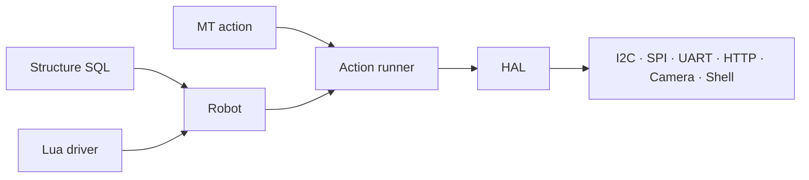

# pymybot

**A three-layer robot controller — structure SQL, Lua drivers and MT action
scripts — with a CLI, a desktop GUI and an AI agent.**

[中文 README](README.md) · [Documentation](docs/README.md) · [Security](SECURITY.md)


## Three entry points

| Entry | Use it for | Command |
| --- | --- | --- |
| GUI | Desktop debugging, demos, per-tool approval | `pymybot` |
| CLI controller | CI/CD, scripts, no model required | `pymybot check / run / sample / ...` |
| AI agent | Natural-language robot control | `pymybot --no-gui --robot ... --task "..."` |

A long-lived `serve` backend exposes the same session over stdio JSON-RPC 2.0
for IDE and custom front-ends.

## Quick start

```sh
git clone https://github.com/gopsc/mybot.git
cd mybot
python -m venv .venv
.venv/bin/pip install -e ".[test]"

.venv/bin/python -m pymybot --version
.venv/bin/python -m pymybot doctor

# No hardware required:
.venv/bin/python -m pymybot run \
  --robot robots/relay-test.sql \
  --input scripts/relay-test.mt --timeout 10

# GUI:
.venv/bin/python -m pymybot

# Agent:
.venv/bin/pip install -e ".[agent,test]"
export MYBOT_MODEL="deepseek:deepseek-chat"
export DEEPSEEK_API_KEY="sk-..."
.venv/bin/python -m pymybot --no-gui \
  --robot robots/relay-test.sql --task "List the hardware"
```

## Design



- Structure SQL declares variables and buses.
- Lua drivers implement `build / call / destroy / read` for one device.
- MT actions describe frames of parameters, captures and control flow.

Static commands never activate hardware. Physical devices, non-loopback HTTP
and the Shell driver require an explicit opt-in. The shell is **not** a sandbox
and Lua is trusted code.

## Multi-language editions

| Edition | Path | Stack |
| --- | --- | --- |
| Python (reference) | root | Python 3.11+ · LuaJIT · PydanticAI |
| Cangjie | [`implementations/cangjie/`](implementations/cangjie) | Cangjie 1.1.3 · LuaJIT |
| C++17 + Rust | [`implementations/cpp-rust/`](implementations/cpp-rust) | C++17 · Rust · LuaJIT |

Each edition is self-contained; see
[`implementations/README.md`](implementations/README.md).

## Documentation

Architecture, CLI, GUI, development, testing, release, versioning and security
guides live in [`docs/`](docs/README.md). Scripting references live in
[`skills/pymybot-scripting/`](skills/pymybot-scripting/SKILL.md).

## Contributing

Read [`CONTRIBUTING.md`](CONTRIBUTING.md). Use issues for bugs/features, keep
the default branch (`gui-mybot`, intended to become `main`) the only long-lived
branch, and never commit credentials.

## License

MIT — see [`LICENSE`](LICENSE).
