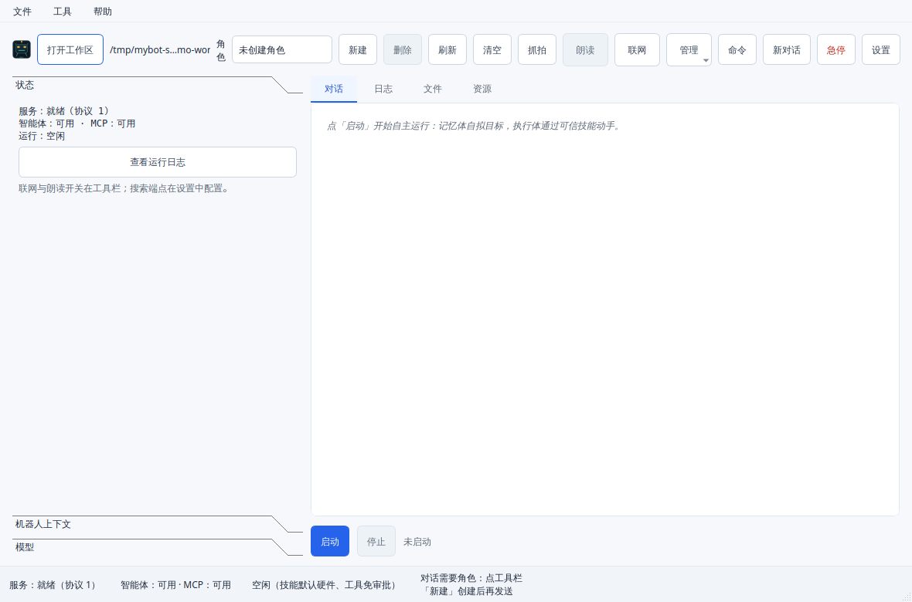
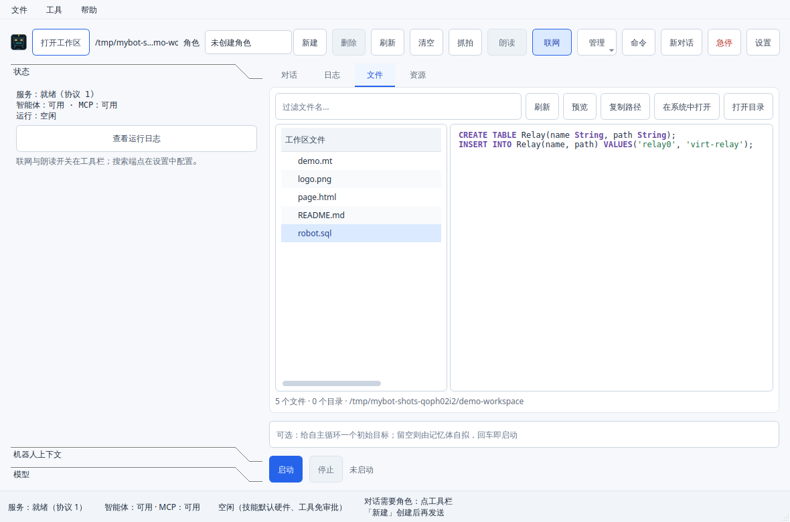
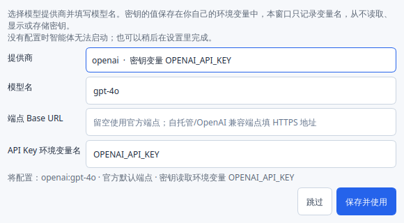

# pymybot

**把「结构 SQL + Python/Lua 驱动 + MT 动作」三层脚本接到真实机器人；同一套后端提供 GUI、CLI、AI Agent 和 MCP 四种入口。**

[](https://github.com/gopsc/mybot/actions/workflows/ci.yml)
[](https://github.com/gopsc/mybot/releases)
[](LICENSE)
[](pyproject.toml)

[Controller Skill](skills/hardware-controller/SKILL.md) · [中文使用指南](docs/Introduce.md) · [双智能体](docs/team.md) · [English](docs/README.en.md) · [文档索引](docs/README.md) · [路线图](docs/roadmap.md) · [安全模型](skills/hardware-controller/references/security.md)



<p>
  
  
</p>

> 以上截图均由 `python tools/gui_screenshots.py` 从真实运行的窗口与真实
> serve 后端自动生成（offscreen 显示、一次性演示工作区），无一伪造。
> 全部视图见 [GUI 指南](docs/gui.md#screenshots)。


## 发起人自白

说来我其实不喜欢用现成框架，我喜欢从零开始手搓。

最开始我只是网上找了个四足蜘蛛机器人，看了下它的代码，是将每个舵机的角度和 sleep 的时间汇总成一个二维数组。我树莓派有文件系统，所以我就把这个数组做成了文本，就是一种矩阵的形态。

所以我表示动作的脚本是 `.mt`。发展到现在，`.mt` 动作脚本已经几乎成了一种编程语言。它调用的对象由 SQL 声明（声明硬件），而 SQL 代码中能够声明的硬件类型由 LuaJIT 或者 Python 构建。

后来又在 MT 中加入了别名、变量、判断、循环、引入这些基本特性，以及控制器、触发器、横向合并、条件反射这些高级特性。这么就构成了一个脚本控制系统。

## 双智能体

Agent 默认拆成两个互相说话的智能体：**记忆体**只做规划与反思，管跨会话的长期记忆；
**执行体**保留技能、文件、Shell、Web、摄像头与 MCP 工具。两者在一个有界的
「规划 → 执行 → 反思」循环里协作，任务、步数与用量落盘到角色目录，可以无人值守地
持续消化任务队列。长期记忆用纯词法 BM25 检索，不依赖向量库或嵌入服务。

```sh
# 点 GUI 的「启动」，或在终端启动：记忆体自拟目标，执行体动手
# （GUI 上方可选填一个初始目标；留空即由记忆体自拟）
pymybot agent --role technician
pymybot agent --role technician --max-missions 5    # 可选：限制本轮任务数
```

细节见 [双智能体](docs/team.md)。

## 许可证

[MIT](LICENSE)
