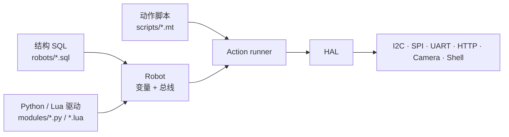

# pymybot

**把「结构 SQL + Python/Lua 驱动 + MT 动作」三层脚本接到真实机器人；同一套后端提供 GUI、CLI、AI Agent 和 MCP 四种入口。**

[](https://github.com/gopsc/mybot/actions/workflows/ci.yml)
[](https://github.com/gopsc/mybot/releases)
[](LICENSE)
[](pyproject.toml)

[English](docs/README.en.md) · [文档索引](docs/README.md) · [路线图](docs/roadmap.md)


> 截图来自 PySide6 窗口和本地回环模型：Agent 列出硬件，经审批执行虚拟动作，再把结果带回来。

## 我们为什么做 pymybot

做硬件项目时，最耗神的往往不是写业务逻辑，而是那些反复出现的琐事：这个传感器接在哪条总线、初始化要发哪几个字节、换一块板子之后脚本要不要重写、出错之后到底发没发出去。等你想让 AI 帮忙，又发现模型再聪明，也没有一层能解释“它到底动了什么”的控制面。

pymybot 想解决的就是这一段。我们用一张结构 SQL 描述机器人身上有什么，用 Python 或 Lua 写器件怎么工作，再用 MT 动作脚本说明这一刻要做什么。总线、权限、审批、回执、日志，以及 GUI、CLI、Agent、MCP 这些入口，由同一套执行器负责。

它不是要替代你的业务代码，而是把“软件怎么安全地碰硬件”这件事收拢到一处。

## 四种入口

同一套后端，四种用法。选一个顺手的就行，不必为桌面、CI 和模型各维护一套逻辑。

| 入口 | 适合谁 | 命令 |
| --- | --- | --- |
| **GUI** | 桌面调试、演示、人工审批每一步 | `pymybot` |
| **CLI 控制器** | CI/CD、脚本、无模型环境 | `pymybot check / run / sample / ...` |
| **AI Agent** | 自然语言控制机器人 | `pymybot --no-gui --robot ... --task "..."` |
| **MCP** | Claude Desktop、Cursor、其他 MCP 客户端 | `pymybot mcp --robot ...` |

另外还有一个长驻的 `serve` 入口，用 stdio JSON-RPC 2.0 给 IDE 或自研前端复用同一套会话。
`mcp` 和 `serve` 共用同一个执行器：工具回执、故障锁存和串行化规则保持一致。

## 我们不想做又一个“聊天壳”

- **三层各管各的**：结构、驱动、动作分开写。换传感器不用改剧本，换剧本也不用碰驱动。
- **没有硬件也能跑**：虚拟总线、寄存器模型、`loop://` 串口回环和逐驱动夹具，让 CI 不用插板子。
- **默认是关着的**：物理总线、非回环 HTTP 和 Shell 都要显式打开。HAL 管得住这些入口，但驱动本身不是沙箱。
- **动作可回看**：动作脚本是矩阵数据，不是任意代码；每次派发、捕获和结果都有 JSON 回执。
- **失败就说清楚**：动作已经派发后出异常，会锁存成“结果未知”。我们不假装回滚，也不把非零退出码说成“没执行”。

## 快速开始

要求 Python 3.11+。先装基础依赖，不接硬件也能把链路跑通。

```sh
git clone https://github.com/gopsc/mybot.git
cd mybot
python -m venv .venv
.venv/bin/pip install -e ".[test]"

.venv/bin/python -m pymybot --version
.venv/bin/python -m pymybot doctor
```

Windows 使用 `.venv\Scripts\pip` 和 `.venv\Scripts\python`。

### 1. 不接硬件，先跑通全链路

```sh
.venv/bin/python -m pymybot check \
  --robot robots/relay-test.sql \
  --input scripts/relay-test.mt

.venv/bin/python -m pymybot run \
  --robot robots/relay-test.sql \
  --input scripts/relay-test.mt \
  --timeout 10
```

输出是一行 JSON：

```json
{"ok":true,"command":"run","outputs":[{"slept":1,"result":"OK"}]}
```

### 2. 打开 GUI

```sh
.venv/bin/pip install -e ".[gui]"
.venv/bin/python -m pymybot
```

GUI 用 PySide6（Qt 6）；只在命令行里用的话，不需要装 `gui` 可选依赖。

第一次打开，在 **设置** 里选 workspace、结构文件和模型。如果你只想控制硬件，不配模型也能用。

### 3. 启用 AI Agent

```sh
.venv/bin/pip install -e ".[agent,test]"
export MYBOT_MODEL="deepseek:deepseek-chat"
export DEEPSEEK_API_KEY="sk-..."
.venv/bin/python -m pymybot --no-gui \
  --robot robots/relay-test.sql \
  --task "列出硬件并解释每个变量的作用"
```

支持的模型提供商有 `openai`、`openai-chat`、`anthropic` 和 `deepseek`。密钥只从环境变量读；自托管端点用 `--base-url`，要求 HTTPS（回环地址除外）。

Agent 也能通过 `--mcp-config` 接外部 MCP 服务，把它们的工具放进同一套逐次审批里：

```sh
.venv/bin/pip install -e ".[agent,mcp]"
.venv/bin/python -m pymybot --no-gui \
  --robot robots/relay-test.sql \
  --task "列出硬件" \
  --mcp-config ./mcp.json
```

提示词分四层：不可变的安全约束、操作员的 `--prompt-file`、有界的工程上下文（工作区/结构/脚本清单），以及运行时的技能/MCP 说明。`--context-bytes` 控制上下文预算（0 关闭，默认 4096）。`--intent auto` 会先判断这次请求是查看、控制、编写还是诊断，只开放对应的工具并收紧预算；混合请求取工具并集，识别不出的闲聊保持原样。

联网工具默认关闭：`--web` 打开 HTTPS 抓取，配了 `--search-endpoint` 才有 SearXNG 搜索。私网/回环地址、超长正文和重定向都会被拒绝，每次请求仍然要审批（`--allow-web` 可以预先批准）。

`mcp.json` 用 Claude Desktop/Cursor 的 `mcpServers` 格式。外部服务是以宿主用户权限运行的可信进程，不是沙箱；结果按 64 KiB 限界，异常回执标成“结果未知”，不会自动重试。

### 4. 作为 MCP 服务端接入 Claude Desktop / Cursor

```sh
.venv/bin/pip install -e ".[mcp]"
.venv/bin/python -m pymybot mcp \
  --robot robots/relay-test.sql \
  --scripts-dir scripts
```

默认只读：`list_hardware`、`query_sql`、`read_action_script` 这些静态工具可以直接用；执行脚本、读变量和抓图要显式加 `--allow-execution`，要碰物理硬件再加 `--allow-hardware`。完整工具表、资源 URI 和客户端配置见 [docs/mcp.md](docs/mcp.md)。

对话默认转录到 `~/.mybot/sessions`，包含工具参数、受限结果和图片；环境变量里的密钥不会被主动读取。转录只用于回看，不能恢复会话。用 `--no-session-log` 或 `MYBOT_SESSION_LOG=0` 关闭，用 `pymybot sessions` 查看，或用 `pymybot sessions --prune --keep 20 --yes` 清理，详见 [docs/cli.md](docs/cli.md#session-transcripts)。

## 架构

可以把三层理解成三样东西：结构 SQL 是接线图，驱动是器件说明书，MT 动作是一轮操作清单。



- **结构 SQL** 说明机器人身上有哪些变量、接在哪条总线、谁引用谁。
- **Python / Lua 驱动** 只负责一个器件的 `build / call`，需要时加 `read / destroy`。
- **MT 动作** 用矩阵描述“第几行对哪个变量发什么参数”，支持捕获、条件、循环和结构 JSON。

完整分层、线程模型和包结构见 [docs/architecture.md](docs/architecture.md)。

## CLI 一览

| 命令 | 作用 | 激活硬件 |
| --- | --- | --- |
| `check` | 静态检查 SQL、模块、引用和 MT/Include 语法 | 否 |
| `hardware` | 列出声明的硬件和元数据 | 否 |
| `scripts` | 列出动作脚本 | 否 |
| `query` | `SHOW TABLES` / `SELECT *` | 否 |
| `run` | 激活、执行一个动作、清理 | 是 |
| `sample` | 采样一个命名变量 | 是 |
| `apply-sql` | 对临时会话应用受限 SQL | 是 |
| `agent` | PydanticAI 任务/REPL | 经审批 |
| `serve` | 长驻 JSON-RPC 服务 | 经请求 |
| `mcp` | 标准 MCP stdio 服务端 | 经 `--allow-execution` |
| `doctor` | 环境、依赖、资产诊断 | 否 |
| `sessions` | 列出或清理 `~/.mybot/sessions` 转录 | 否 |

退出码：`0` 成功，`1` 运行错误，`2` 用法错误，`130` 中断。完整参数、JSON 契约和 `serve` 协议见 [docs/cli.md](docs/cli.md)。

## GUI

GUI 是一个前端，不重复实现机器人逻辑：窗口只启动一个 `serve` 子进程，所有机器人和模型调用都走同一条链路。

- 启动先显示复古风入口界面：SVG 机器人 logo、扫描线、真实的 serve 状态、`进入控制台` 按钮和淡入过渡；`--no-splash` 可以跳过。
- 左侧是 workspace、脚本/技能/模块/MCP 配置、硬件树、权限与预算，以及模型摘要。
- 右侧是对话、日志、资源三个标签页。资源页能预览结构 SQL、Python/Lua 驱动、脚本、技能和文档，支持 Markdown 渲染、语法高亮、按 mtime 缓存和文件变化自动刷新。
- 菜单和工具栏里有命令面板（check/hardware/scripts/query/run/sample/apply-sql/doctor/sessions）、MCP 配置编辑器、会话管理、环境诊断、文档和关于。
- 对话支持流式输出、忙碌指示、重试、清空和复制；危险工具会逐次弹窗确认。
- `允许硬件`、`自动批准动作`、文件写入、Shell 和 MCP 自动批准都在每次启动时重新确认，不落盘；文件/Shell 工具默认关闭。
- 重启、取消和崩溃恢复都有测试覆盖。

详见 [docs/gui.md](docs/gui.md)，里面有设置、资源预览、MCP 编辑器、会话管理和诊断截图。

## 写一个驱动

SQL 普通表名会选择 `modules/<表名>.py` 或 `.lua`（`Alias` / `Vars` / `Daemon` 除外）。模块按根目录顺序查找，**每个根内先 `.py` 后 `.lua`**；较早根目录里的 Lua 仍优先于较晚根目录里的 Python。可以用 `--module-path DIR` 重复指定根目录。激活时，每一行独立执行 Python 模块并创建一个 `Driver(context)`。

- 必需方法：`build(data)`、`call(data)`；可选 `read(data)`（缺省回退到 `call`）和 `destroy(data)`。
- `data` 是结构元数据、动作参数和触发结果组成的字典；返回非空字典。`result` 可以省略，或用 `"OK"` 表示成功、用 `"ERR"` + `message` 报错。
- `context.call(operation, *args)` 调用已有的 HAL 操作，权限检查、句柄归属和取消检查都还在；`context.check()` 检查协作预算。`check` 只编译 Python 源码，不执行模块、构造器或驱动方法。
- 内置的 I2C/SPI/UART/HTTP/Camera/Shell 普通表已经迁到 Python；HAL 总线句柄仍然可以给 Lua 器件驱动用。I2C/SPI/UART 的 `proto=virt` / `virt-*` 会显式使用保留的 Lua 虚拟实现，不会悄悄回落到真实硬件。既有 Daemon chunk 仍只支持 Lua；如果选中 Python 驱动，静态检查会直接拒绝。

仓库自带一个 pyserial `loop://` 回环示例，不需要物理硬件、模型或凭据。结构 `robots/uart-loopback.sql`：

```sql
CREATE TABLE UART (name String, path String, baud Number);
INSERT INTO UART (name, path, baud) VALUES ('bus', 'loop://', 115200);
CREATE TABLE LoopbackProbe (name String, UART String);
INSERT INTO LoopbackProbe (name, UART) VALUES ('echo', '$bus');
```

动作 `scripts/uart-loopback.mt`：

```mt
@Action
echo.value;
         0;
       127;
       255;
@
```

自定义驱动 `modules/LoopbackProbe.py`（`$bus` 合并出的 `fd` 由 UART 行拥有并释放）：

```python
from pymybot.errors import DriverError


class Driver:
    def __init__(self, context):
        self.context = context

    def build(self, data):
        return {"result": "OK"}

    def call(self, data):
        fd = data["fd"]
        value = data.get("value", 0)
        if self.context.call("uart_write", fd, [value]) != 1:
            raise DriverError("UART write failed: " + self.context.call("last_error"))
        reply = self.context.call("uart_read", fd, 1, 200)
        if reply is None or len(reply) != 1:
            raise DriverError("UART echo timed out or failed")
        return {"result": "OK", "rx": reply[0]}
```

从仓库根检查并运行，结果依次含 `rx: 0`、`rx: 127`、`rx: 255`：

```sh
.venv/bin/python -m pymybot check --module-path modules \
  --robot robots/uart-loopback.sql --input scripts/uart-loopback.mt
.venv/bin/python -m pymybot run --module-path modules \
  --robot robots/uart-loopback.sql --input scripts/uart-loopback.mt --timeout 10
```

完整规则见 [驱动参考](skills/pymybot-scripting/references/driver-lua.md)。

## 安全边界

默认关掉，需要时再打开。这不是为了显得谨慎，而是因为硬件动作很难撤回。

| 能力 | 默认 | 打开方式 |
| --- | --- | --- |
| 物理 I2C/SPI/UART | 关闭 | `--allow-hardware` |
| 非回环 HTTP | 关闭 | `--allow-hardware` |
| Shell 驱动 | 关闭 | `--allow-hardware` |
| Agent 动作/读取/拍照 | 逐次确认 | `--allow-actions` 或弹窗 |
| Agent 文件写入 | 关闭 | `--workspace-dir` + `--allow-file-writes` |
| Agent Shell | 关闭 | `--enable-shell` + `--allow-shell` |
| MCP 服务端执行 | 关闭 | `--allow-execution`（物理硬件另需 `--allow-hardware`） |
| Agent 外部 MCP 工具 | 逐次确认 | `--allow-mcp-tools`（外部服务不是沙箱） |

**Agent Shell 默认尝试 bubblewrap（可用时）；不可用时退回工作区牢笼，两者都要显式启用和审批。**
Python / Lua 驱动是可信的进程内代码，**不是沙箱**。Python 的 import 和直接原生 I/O 不受限制，上表的 HAL 权限也管不到这类直接访问。Python 的预算/取消是协作式的：长循环应该调用 `context.check()`；阻塞的原生调用或不合作的 Python 循环没法被硬中断。只运行你审阅过的驱动；动作派发后不保证物理回滚。完整威胁模型见 [docs/security.md](docs/security.md)。

## 兼容性

| 平台 | UART | I2C/SPI | Camera | GUI |
| --- | --- | --- | --- | --- |
| Linux | pyserial | pyftdi MPSSE / `smbus2` / `spidev` | PyAV V4L2 | PySide6 |
| Windows | pyserial `COMn` | pyftdi MPSSE | PyAV DirectShow | PySide6 |
| macOS | pyserial | pyftdi MPSSE | PyAV AVFoundation（14+） | PySide6 |

不提供 GPIO/PWM/Speaker 原生后端；这类外设请通过受支持的总线写协议实现。没有硬件时，用 `*_virt.sql` 或 `loop://`。

## 目录结构

```text
pymybot/                  Python 包：CLI、SQL、动作执行、HAL、Daemon、Agent、GUI、MCP
modules/                  Python 原生驱动、保留的 Lua 驱动和公共库
robots/                   结构 SQL 示例（含虚拟设备）
scripts/                  MT 动作示例
skills/                   Agent 参考技能
tests/                    pytest 与逐驱动虚拟夹具
docs/                     架构、CLI、GUI、开发、测试、发布、安全文档
docs/history/             已完成的迁移与调试记录
tools/                    打包与 CI 辅助（PyInstaller spec、smoke 脚本、Nuitka 实验命令）
.github/                  CI、发布工作流、Issue/PR 模板、社区规范
```

## 文档

| 想了解 | 从这里开始 |
| --- | --- |
| 全部文档 | [docs/README.md](docs/README.md) |
| 架构与数据流 | [docs/architecture.md](docs/architecture.md) |
| CLI / JSON / serve | [docs/cli.md](docs/cli.md) |
| MCP 服务端与客户端 | [docs/mcp.md](docs/mcp.md) |
| GUI | [docs/gui.md](docs/gui.md) |
| 开发与打包 | [docs/development.md](docs/development.md) |
| 测试与 CI 通道 | [docs/testing.md](docs/testing.md) |
| 版本与发布 | [docs/release.md](docs/release.md) · [docs/versioning.md](docs/versioning.md) |
| 安全模型 | [docs/security.md](docs/security.md) · [.github/SECURITY.md](.github/SECURITY.md) |
| 常见问题 | [docs/faq.md](docs/faq.md) |
| 分支迁移历史 | [docs/history/README.md](docs/history/README.md) |
| 路线图 | [docs/roadmap.md](docs/roadmap.md) |

## 开发与 CI

```sh
python -m pytest -q
python -I tools/ci_smoke.py base
python -I tools/ci_smoke.py wheel
```

CI 覆盖 Python 3.11–3.14、Windows、Agent（离线模型）、wheel/sdist 干净安装和 README 快速开始。发布由 tag 触发，产出 sdist、wheel、Windows GUI zip 和 `SHA256SUMS`。

## 贡献

欢迎驱动、文档、测试和前端贡献。动手前先读 [.github/CONTRIBUTING.md](.github/CONTRIBUTING.md)：

- Bug 或功能建议先开 Issue；小修可以直接提 PR。
- 用 Conventional Commits；默认分支（`gui-mybot`，owner 之后可以改名为 `main`）是唯一长驻分支。
- 不要提交密钥、生成物或无关格式化。
- 安全漏洞请走私密渠道：[.github/SECURITY.md](.github/SECURITY.md)。

## 许可证

[MIT](LICENSE)。
