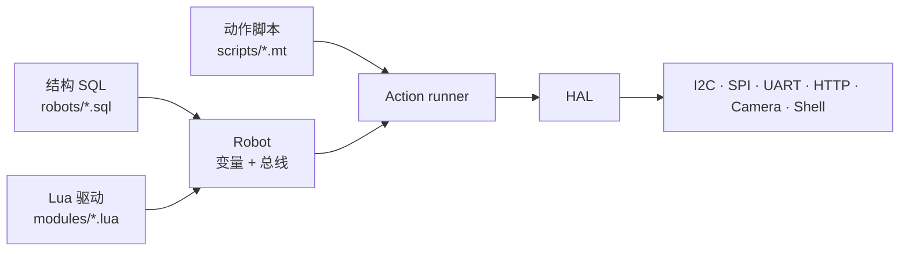

# pymybot

**把「结构 SQL + Lua 驱动 + MT 动作」三层脚本接到真实机器人；同一套代码提供 CLI、桌面 GUI 和 AI Agent。**

[](https://github.com/gopsc/mybot/actions/workflows/ci.yml)
[](https://github.com/gopsc/mybot/releases)
[](LICENSE)
[](pyproject.toml)

[English](docs/README.en.md) · [文档索引](docs/README.md) · [路线图](docs/roadmap.md)


> 截图来自本地回环演示端点：Agent 先调用 `list_hardware`，再解释得到的硬件上下文。

## 三种入口

| 入口 | 适合谁 | 命令 |
| --- | --- | --- |
| **GUI** | 桌面调试、演示、人工审批每一步 | `pymybot` |
| **CLI 控制器** | CI/CD、脚本、无模型环境 | `pymybot check / run / sample / ...` |
| **AI Agent** | 自然语言控制机器人 | `pymybot --no-gui --robot ... --task "..."` |

另有一个长驻 `serve` 入口，用 stdio JSON-RPC 2.0 给 IDE 或自研前端复用同一套会话。

## 为什么不是又一个“聊天壳”

- **三层解耦**：结构、驱动、动作各写各的；换传感器不改剧本，换剧本不碰驱动。
- **无硬件可跑通**：虚拟总线、寄存器模型、`loop://` 串口回环和逐驱动夹具，让 CI 不需要插板子。
- **默认安全**：静态命令不激活设备；物理总线、非回环 HTTP 和 Shell 都要显式开关。
- **可审计的动作**：动作脚本是矩阵数据，不是任意代码；每次派发、捕获和结果都有 JSON 回执。
- **失败说清楚**：动作已派发后的异常锁存为“结果未知”，不假装回滚；非零退出码不是“未执行”。
- **多语言同仓**：Python 参考实现、Cangjie 版、C++17 + Rust 版共用同一套脚本模型。

## 快速开始

要求 Python 3.11+。

```sh
git clone https://github.com/gopsc/mybot.git
cd mybot
python -m venv .venv
.venv/bin/pip install -e ".[test]"

.venv/bin/python -m pymybot --version
.venv/bin/python -m pymybot doctor
```

Windows 使用 `.venv\Scripts\pip` 和 `.venv\Scripts\python`。

### 1. 不接硬件，先跑通全链路

```sh
.venv/bin/python -m pymybot check \
  --robot robots/relay-test.sql \
  --input scripts/relay-test.mt

.venv/bin/python -m pymybot run \
  --robot robots/relay-test.sql \
  --input scripts/relay-test.mt \
  --timeout 10
```

输出是一行 JSON：

```json
{"ok":true,"command":"run","outputs":[{"slept":1,"result":"OK"}]}
```

### 2. 打开 GUI

```sh
.venv/bin/python -m pymybot
```

首次使用在 **设置** 中选择 workspace、结构文件和模型；如果只想控制硬件，不需要模型配置。

### 3. 启用 AI Agent

```sh
.venv/bin/pip install -e ".[agent,test]"
export MYBOT_MODEL="deepseek:deepseek-chat"
export DEEPSEEK_API_KEY="sk-..."
.venv/bin/python -m pymybot --no-gui \
  --robot robots/relay-test.sql \
  --task "列出硬件并解释每个变量的作用"
```

支持的模型提供商：`openai`、`openai-chat`、`anthropic`、`deepseek`。密钥只从环境变量读取；自托管端点用 `--base-url`，要求 HTTPS（回环地址除外）。

对话默认转录到 `~/.mybot/sessions`（含工具参数、受限结果与图片；环境变量中的密钥不会被主动读取）。转录只用于回看，不能恢复会话；用 `--no-session-log` 或 `MYBOT_SESSION_LOG=0` 关闭，用 `pymybot sessions` 查看或 `pymybot sessions --prune --keep 20 --yes` 清理，详见 [docs/cli.md](docs/cli.md#session-transcripts)。

## 架构



- **结构 SQL** 声明机器人身上有哪些变量、接在哪条总线、谁引用谁。
- **Lua 驱动** 实现一个器件的 `build / call / destroy / read`。
- **MT 动作** 用矩阵描述“第几行对哪个变量发什么参数”，支持捕获、条件、循环和结构 JSON。

完整分层、线程模型和包结构见 [docs/architecture.md](docs/architecture.md)。

## 多语言实现

| 版本 | 目录 | 技术栈 | 版本 |
| --- | --- | --- | --- |
| Python（参考实现） | 仓库根目录 | Python 3.11+ · LuaJIT · PydanticAI | 0.3.x |
| Cangjie | [`implementations/cangjie/`](implementations/cangjie) | 仓颉 1.1.3 · LuaJIT | 0.3.3 |
| C++17 + Rust Agent | [`implementations/cpp-rust/`](implementations/cpp-rust) | C++17 · Rust · LuaJIT | 0.1.0 |

三个版本共享同一套脚本模型，但 HAL ABI、构建系统和发布物各自独立。不要在版本之间直接复制驱动，先读各自 README 和 [`implementations/README.md`](implementations/README.md)。

## CLI 一览

| 命令 | 作用 | 激活硬件 |
| --- | --- | --- |
| `check` | 静态检查 SQL、模块、引用和 MT/Include 语法 | 否 |
| `hardware` | 列出声明的硬件和元数据 | 否 |
| `scripts` | 列出动作脚本 | 否 |
| `query` | `SHOW TABLES` / `SELECT *` | 否 |
| `run` | 激活、执行一个动作、清理 | 是 |
| `sample` | 采样一个命名变量 | 是 |
| `apply-sql` | 对临时会话应用受限 SQL | 是 |
| `agent` | PydanticAI 任务/REPL | 经审批 |
| `serve` | 长驻 JSON-RPC 服务 | 经请求 |
| `doctor` | 环境、依赖、资产诊断 | 否 |
| `sessions` | 列出或清理 `~/.mybot/sessions` 转录 | 否 |

退出码：`0` 成功，`1` 运行错误，`2` 用法错误，`130` 中断。完整参数、JSON 契约和 `serve` 协议见 [docs/cli.md](docs/cli.md)。

## GUI

- 左侧：workspace、脚本/技能/模块路径、硬件树、权限与预算、模型摘要。
- 右侧：对话、工具调用、日志双标签页；底部输入框 `Ctrl+Enter` 发送。
- 危险工具逐次弹窗确认；`允许硬件` 和 `自动批准动作` 每次启动都重新确认，不落盘。
- GUI 只驱动一个 `serve` 子进程，不重复实现机器人逻辑；重启、取消和崩溃恢复都有测试覆盖。

详见 [docs/gui.md](docs/gui.md)。

## 脚本示例

结构文件：

```sql
CREATE TABLE UART (name String, path String, baud Number);
INSERT INTO UART (name, path, baud) VALUES ('bus', 'loop://', 115200);
CREATE TABLE LoopbackProbe (name String, UART String);
INSERT INTO LoopbackProbe (name, UART) VALUES ('echo', '$bus');
```

动作脚本：

```mt
@Action
echo.value;
         0;
       127;
@
```

驱动：

```lua
local mpath = assert(__mpath)
dofile(mpath.resolve("lib/drv_common.lua"))
require_driver("uart", {
    name = "LoopbackProbe",
    build = function(ctx, data) return {result = "OK"} end,
    call = function(ctx, data)
        if uart_write(ctx.fd, {tonumber(data.value)}) ~= 1 then return err("short write") end
        local reply = uart_read(ctx.fd, 1, 200)
        if reply == nil or #reply ~= 1 then return err("read failed") end
        return {result = "OK", rx = reply[1]}
    end,
})
```

完整规则见 [skills/pymybot-scripting](skills/pymybot-scripting/SKILL.md)。

## 安全边界

| 能力 | 默认 | 打开方式 |
| --- | --- | --- |
| 物理 I2C/SPI/UART | 关闭 | `--allow-hardware` |
| 非回环 HTTP | 关闭 | `--allow-hardware` |
| Shell 驱动 | 关闭 | `--allow-hardware` |
| Agent 动作/读取/拍照 | 逐次确认 | `--allow-actions` 或弹窗 |
| Agent 文件写入 | 关闭 | `--workspace-dir` + `--allow-file-writes` |
| Agent Shell | 关闭 | `--enable-shell` + `--allow-shell` |

**Shell 不是沙箱，Lua 是可信代码。** 只运行审阅过的驱动；动作派发后不保证物理回滚。完整威胁模型见 [docs/security.md](docs/security.md)。

## 兼容性

| 平台 | UART | I2C/SPI | Camera | GUI |
| --- | --- | --- | --- | --- |
| Linux | pyserial | pyftdi MPSSE / `smbus2` / `spidev` | PyAV V4L2 | Tk |
| Windows | pyserial `COMn` | pyftdi MPSSE | PyAV DirectShow | Tk |
| macOS | pyserial | pyftdi MPSSE | PyAV AVFoundation（14+） | Tk |

不提供 GPIO/PWM/Speaker 原生后端；这些外设请通过受支持总线写协议实现。无硬件时使用 `*_virt.sql` 或 `loop://`。

## 目录结构

```text
pymybot/                  Python 包：CLI、SQL、动作执行、HAL、Daemon、Agent、GUI
modules/                  Lua 总线、驱动和公共库
robots/                   结构 SQL 示例（含虚拟设备）
scripts/                  MT 动作示例
skills/                   Agent 参考技能
tests/                    pytest 与逐驱动虚拟夹具
docs/                     架构、CLI、GUI、开发、测试、发布、安全文档
docs/history/             已完成的迁移与调试记录
implementations/          Cangjie 与 C++17 + Rust 版本（各自独立构建）
tools/                    打包与 CI 辅助（PyInstaller spec、smoke 脚本、Nuitka 实验命令）
.github/                  CI、发布工作流、Issue/PR 模板、社区规范
```

## 文档

| 想了解 | 从这里开始 |
| --- | --- |
| 全部文档 | [docs/README.md](docs/README.md) |
| 架构与数据流 | [docs/architecture.md](docs/architecture.md) |
| CLI / JSON / serve | [docs/cli.md](docs/cli.md) |
| GUI | [docs/gui.md](docs/gui.md) |
| 开发与打包 | [docs/development.md](docs/development.md) |
| 测试与 CI 通道 | [docs/testing.md](docs/testing.md) |
| 版本与发布 | [docs/release.md](docs/release.md) · [docs/versioning.md](docs/versioning.md) |
| 安全模型 | [docs/security.md](docs/security.md) · [.github/SECURITY.md](.github/SECURITY.md) |
| 常见问题 | [docs/faq.md](docs/faq.md) |
| 分支迁移历史 | [docs/history/README.md](docs/history/README.md) |
| 路线图 | [docs/roadmap.md](docs/roadmap.md) |

## 开发与 CI

```sh
python -m pytest -q
python -I tools/ci_smoke.py base
python -I tools/ci_smoke.py wheel
```

CI 覆盖 Python 3.11–3.14、Windows、Agent（离线模型）、wheel/sdist 干净安装和 README 快速开始。发布由 tag 触发，产出 sdist、wheel、Windows GUI zip 和 `SHA256SUMS`。

## 贡献

欢迎驱动、文档、测试和前端贡献。请先读 [.github/CONTRIBUTING.md](.github/CONTRIBUTING.md)：

- Bug/功能先开 Issue；小修可直接提 PR。
- Conventional Commits；默认分支（`gui-mybot`，owner 可后续改名为 `main`）是唯一长驻分支。
- 不提交密钥、生成物或无关格式化。
- 安全漏洞走私密渠道：[.github/SECURITY.md](.github/SECURITY.md)。

## 许可证

[MIT](LICENSE)。各语言版本保留自己的版权声明；见 `implementations/*/LICENSE`。
