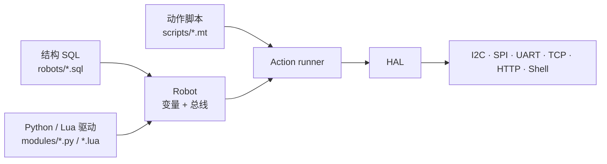

# pymybot 使用指南

从安装到跑通第一个动作，再到 MCP 和自定义驱动。项目背景见 [README](../README.md)。

## 我们为什么做 pymybot

做硬件项目时，最耗神的往往不是写业务逻辑，而是那些反复出现的琐事：这个传感器接在哪条总线、初始化要发哪几个字节、换一块板子之后脚本要不要重写、出错之后到底发没发出去。

pymybot 想解决的就是这一段。我们用一张结构 SQL 描述机器人身上有什么，用 Python 或 Lua 写器件怎么工作，再用 MT 动作脚本说明这一刻要做什么。总线、权限、回执、日志，以及 CLI 和 MCP 两个入口，由同一套执行器负责。

它不是要替代你的业务代码，而是把“软件怎么安全地碰硬件”这件事收拢到一处。

## 两种入口

同一套后端，两种用法。选一个顺手的就行，不必为 CI 和桌面客户端各维护一套逻辑。

| 入口 | 适合谁 | 命令 |
| --- | --- | --- |
| **CLI 控制器** | CI/CD、脚本、无模型环境 | `pymybot check / run / sample / ...` |
| **MCP** | Claude Desktop、Cursor、其他 MCP 客户端 | `pymybot mcp --robot ...` |

两个入口共用同一个执行器：回执格式、故障锁存和串行化规则保持一致。不带子命令时会报
用法错误（退出码 2）；用 `pymybot --help` 查看帮助。

## 我们刻意没有做的事

- **三层各管各的**：结构、驱动、动作分开写。换传感器不用改剧本，换剧本也不用碰驱动。
- **没有硬件也能跑**：虚拟总线、寄存器模型、`loop://` 串口回环和逐驱动夹具，让 CI 不用插板子。
- **默认是关着的**：物理总线、非回环 HTTP/TCP 和 Shell 都要显式打开。HAL 管得住这些入口，但驱动本身不是沙箱。
- **动作不是任意代码**：动作脚本是矩阵数据；每次派发、捕获和结果都有 JSON 回执。
- **失败就说清楚**：动作已经派发后出异常，会锁存成“结果未知”。我们不假装回滚，也不把非零退出码说成“没执行”。

## 快速开始

要求 Python 3.11+。先装基础依赖，不接硬件也能把链路跑通。

```sh
git clone https://github.com/gopsc/mybot.git
cd mybot
python -m venv .venv
.venv/bin/pip install -e ".[test]"

.venv/bin/python -m pymybot --version
.venv/bin/python -m pymybot doctor
```

Windows 使用 `.venv\Scripts\pip` 和 `.venv\Scripts\python`。

### 1. 不接硬件，先跑通全链路

```sh
.venv/bin/python -m pymybot check \
  --robot skills/hardware-controller/assets/robots/relay-test.sql \
  --input skills/hardware-controller/assets/scripts/relay-test.mt

.venv/bin/python -m pymybot run \
  --robot skills/hardware-controller/assets/robots/relay-test.sql \
  --input skills/hardware-controller/assets/scripts/relay-test.mt \
  --timeout 10
```

输出是一行 JSON：

```json
{"ok":true,"command":"run","outputs":[{"slept":1,"result":"OK"}]}
```

`new` 可以在当前目录生成可运行的 `robots/`、`scripts/`、`modules/` 骨架：

```sh
.venv/bin/python -m pymybot new mybot-arm
```

### 2. 作为 MCP 服务端接入 Claude Desktop / Cursor

```sh
.venv/bin/pip install -e ".[mcp]"
.venv/bin/python -m pymybot mcp \
  --robot skills/hardware-controller/assets/robots/relay-test.sql \
  --scripts-dir skills/hardware-controller/assets/scripts
```

默认只读：`get_status`、`list_hardware`、`list_action_scripts`、`read_action_script`、
`query_sql` 这些静态工具可以直接用；`run_action_script` 和 `read_variables` 要显式加
`--allow-execution`，要碰物理硬件再加 `--allow-hardware`（它要求同时给出
`--allow-execution`）。服务端只暴露 `mybot://scripts/...` 资源。完整工具表、回执信封和
客户端配置见 [MCP 指南](../skills/hardware-controller/references/mcp.md)。

## 架构

可以把三层理解成三样东西：结构 SQL 是接线图，驱动是器件说明书，MT 动作是一轮操作清单。



- **结构 SQL** 说明机器人身上有哪些变量、接在哪条总线、谁引用谁。
- **Python / Lua 驱动** 只负责一个器件的 `build / call`，需要时加 `read / destroy`。
- **MT 动作** 用矩阵描述“第几行对哪个变量发什么参数”，支持捕获、条件、循环和结构 JSON。

完整分层、线程模型和包结构见 [架构与 Runtime flow](../skills/hardware-controller/references/architecture.md)。

## CLI 一览

| 命令 | 作用 | 激活硬件 |
| --- | --- | --- |
| `new` | 生成可运行的 `robots/`、`scripts/`、`modules/` 骨架 | 否 |
| `check` | 静态检查 SQL、模块、引用和 MT/Include 语法 | 否 |
| `discover` | 只读枚举宿主 UART/FTDI/I2C/SPI 设备并建议结构 SQL | 否 |
| `hardware` | 列出声明的硬件和元数据 | 否 |
| `scripts` | 列出动作脚本 | 否 |
| `query` | `SHOW TABLES` / `SELECT *` | 否 |
| `run` | 激活、执行一个动作、清理 | 是 |
| `sample` | 采样一个命名变量 | 是 |
| `apply-sql` | 对临时激活的机器人应用受限 SQL，不写入结构文件 | 是 |
| `mcp` | 标准 MCP stdio 服务端 | 经 `--allow-execution` |
| `doctor` | 环境、依赖、资产诊断 | 否 |
| `assets` | 列出、读取、写入、删除内置 robots/modules/scripts 资产 | 否 |

退出码：`0` 成功，`1` 运行错误，`2` 用法错误，`130` 中断。完整参数和 JSON 契约见
[CLI 参考](../skills/hardware-controller/references/cli.md)。

## 写一个驱动

SQL 普通表名会选择 `modules/<表名>.py` 或 `.lua`（`Alias` / `Vars` / `Daemon` 除外）。模块按根目录顺序查找，**每个根内先 `.py` 后 `.lua`**；较早根目录里的 Lua 仍优先于较晚根目录里的 Python。可以用 `--module-path DIR` 重复指定根目录。激活时，每一行独立执行 Python 模块并创建一个 `Driver(context)`。

- 必需方法：`build(data)`、`call(data)`；可选 `read(data)`（缺省回退到 `call`）和 `destroy(data)`。
- `data` 是结构元数据、动作参数和触发结果组成的字典；返回非空字典。`result` 可以省略，或用 `"OK"` 表示成功、用 `"ERR"` + `message` 报错。
- `context.call(operation, *args)` 调用已有的 HAL 操作，权限检查、句柄归属和取消检查都还在；`context.check()` 检查协作预算。`check` 只编译 Python 源码，不执行模块、构造器或驱动方法。
- 内置的 I2C/SPI/UART/TCP/HTTP/Shell 普通表已经迁到 Python；HAL 总线句柄仍然可以给 Lua 器件驱动用。Python I2C/SPI/UART 会把显式 `proto=virt` 或 `virt-*` 路径的总线打开为纯内存 HAL 句柄，禁止物理访问；既有的 `proto=virt` 搭配 `/dev/...` 路径写法仍保持虚拟语义，不会悄悄回落到真实硬件。Lua 器件驱动继续复用现有 `virtbus` 模型与实例隔离。既有 Daemon chunk 仍只支持 Lua；如果选中 Python 驱动，静态检查会直接拒绝。

仓库自带一个 pyserial `loop://` 回环示例，不需要物理硬件和凭据。结构 [`skills/hardware-controller/assets/robots/uart-loopback.sql`](../skills/hardware-controller/assets/robots/uart-loopback.sql)：

```sql
CREATE TABLE UART (name String, path String, baud Number);
INSERT INTO UART (name, path, baud) VALUES ('bus', 'loop://', 115200);
CREATE TABLE LoopbackProbe (name String, UART String);
INSERT INTO LoopbackProbe (name, UART) VALUES ('echo', '$bus');
```

动作 [`skills/hardware-controller/assets/scripts/uart-loopback.mt`](../skills/hardware-controller/assets/scripts/uart-loopback.mt)：

```mt
@Action
echo.value;
         0;
       127;
       255;
@
```

自定义驱动 [`modules/LoopbackProbe.py`](../skills/hardware-controller/assets/modules/LoopbackProbe.py)（`$bus` 合并出的 `fd` 由 UART 行拥有并释放）：

```python
from pymybot.errors import DriverError


class Driver:
    def __init__(self, context):
        self.context = context

    def build(self, data):
        return {"result": "OK"}

    def call(self, data):
        fd = data["fd"]
        value = data.get("value", 0)
        if self.context.call("uart_write", fd, [value]) != 1:
            raise DriverError("UART write failed: " + self.context.call("last_error"))
        reply = self.context.call("uart_read", fd, 1, 200)
        if reply is None or len(reply) != 1:
            raise DriverError("UART echo timed out or failed")
        return {"result": "OK", "rx": reply[0]}
```

从仓库根检查并运行，结果依次含 `rx: 0`、`rx: 127`、`rx: 255`：

```sh
.venv/bin/python -m pymybot check \
  --robot skills/hardware-controller/assets/robots/uart-loopback.sql --input skills/hardware-controller/assets/scripts/uart-loopback.mt
.venv/bin/python -m pymybot run \
  --robot skills/hardware-controller/assets/robots/uart-loopback.sql --input skills/hardware-controller/assets/scripts/uart-loopback.mt --timeout 10
```

TCP 可直接由 MT 控制：[结构示例](../skills/hardware-controller/assets/robots/tcp.sql) 只配置 `name`、`host`、`port`，
[动作示例](../skills/hardware-controller/assets/scripts/tcp.mt) 使用 `connect`、`close`、`timeout`、`num_recv`、`send_hex`、
`send_str`、`recv_hex`、`recv_str`。激活不自动连接；需要先启动本地 TCP 回显服务，
再显式执行 `net.connect`。发送文本用 MT 字符串表达式，如 `$("你好")`。

完整规则见 [驱动参考](../skills/hardware-controller/references/driver-lua.md)。

## 安全边界

默认关掉，需要时再打开。这不是为了显得谨慎，而是因为硬件动作很难撤回。

| 能力 | 默认 | 打开方式 |
| --- | --- | --- |
| 物理 I2C/SPI/UART | 关闭 | `--allow-hardware` |
| 非回环 HTTP/TCP | 关闭 | `--allow-hardware` |
| Shell 驱动 | 关闭 | `--allow-hardware` |
| MCP 服务端执行 | 关闭 | `--allow-execution`（物理硬件另需 `--allow-hardware`） |

`check`、`hardware`、`scripts` 和 `query` 只做静态读取，从不激活驱动；`run`、`sample`
和 `apply-sql` 会激活机器人。

Python / Lua 驱动是可信的进程内代码，**不是沙箱**。Python 的 import 和直接原生 I/O 不受限制，上表的 HAL 权限也管不到这类直接访问。Python 的预算/取消是协作式的：长循环应该调用 `context.check()`；阻塞的原生调用或不合作的 Python 循环没法被硬中断。只运行你审阅过的驱动；动作派发后不保证物理回滚。完整威胁模型见 [安全模型](../skills/hardware-controller/references/security.md)。

## 兼容性

| 平台 | UART | I2C/SPI |
| --- | --- | --- |
| Linux | pyserial | pyftdi MPSSE / `smbus2` / `spidev` |
| Windows | pyserial `COMn` | pyftdi MPSSE |
| macOS | pyserial | pyftdi MPSSE |

macOS arm64 的 `lupa` wheel 可能不包含 LuaJIT；此时 `pymybot` 会回退到标准 Lua，
Python 驱动仍可用，但依赖 LuaJIT FFI 的 Lua 驱动不可用。`doctor` 会报告
`LuaJIT FFI` 警告；需要这些驱动时请安装带 LuaJIT 的 `lupa` 构建。

不提供 GPIO/PWM/Speaker 原生后端；这类外设请通过受支持的总线写协议实现。没有硬件时，用 `*_virt.sql` 或 `loop://`。

## 目录结构

```text
pymybot/                  版本号与 import shim（把技能内 Runtime 加进 __path__）
skills/hardware-controller/scripts/pymybot/  控制器与 MCP Python Runtime
skills/hardware-controller/references/       控制器权威文档
skills/hardware-controller/assets/modules/   Python 原生驱动、保留的 Lua 驱动和公共库
skills/hardware-controller/assets/robots/    结构 SQL 示例（含虚拟设备）
skills/hardware-controller/assets/scripts/   MT 动作示例
tests/                    pytest 与逐驱动虚拟夹具
docs/                     开发、发布、版本、FAQ 与历史文档
docs/history/             已完成的迁移与调试记录
tools/                    CI、文档检查与发布辅助脚本
.github/                  CI、发布工作流、Issue/PR 模板、社区规范
```

## 更多文档

| 想了解 | 从这里开始 |
| --- | --- |
| 全部文档 | [docs/README.md](README.md) |
| 架构与数据流 | [架构与 Runtime flow](../skills/hardware-controller/references/architecture.md) |
| CLI / JSON | [CLI 参考](../skills/hardware-controller/references/cli.md) |
| MCP 服务端与客户端 | [MCP 指南](../skills/hardware-controller/references/mcp.md) |
| 开发与打包 | [docs/development.md](development.md) |
| 测试与 CI 通道 | [测试与虚拟设备](../skills/hardware-controller/references/testing.md) |
| 版本与发布 | [docs/release.md](release.md) · [docs/versioning.md](versioning.md) |
| 安全模型 | [安全模型](../skills/hardware-controller/references/security.md) · [.github/SECURITY.md](../.github/SECURITY.md) |
| 常见问题 | [docs/faq.md](faq.md) |
| 分支迁移历史 | [docs/history/README.md](history/README.md) |
| 路线图 | [docs/roadmap.md](roadmap.md) |

## 开发与 CI

```sh
python -m pytest -q
python -I tools/ci_smoke.py wheel
```

CI 覆盖 Python 3.11–3.14、Windows、wheel/sdist 干净安装和上文快速开始。发布由 tag 触发，产出 sdist、wheel 和 `SHA256SUMS`。

## 贡献

欢迎驱动、文档和测试贡献。动手前先读 [.github/CONTRIBUTING.md](../.github/CONTRIBUTING.md)：

- Bug 或功能建议先开 Issue；小修可以直接提 PR。
- 用 Conventional Commits；默认分支（`gui-mybot`，owner 之后可以改名为 `main`）是唯一长驻分支。
- 不要提交密钥、生成物或无关格式化。
- 安全漏洞请走私密渠道：[.github/SECURITY.md](../.github/SECURITY.md)。

## 许可证

[MIT](../LICENSE)。
