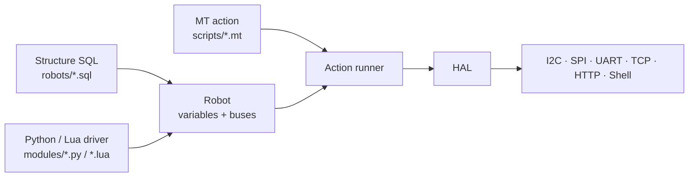

# pymybot

**A three-layer robot controller — structure SQL, Python/Lua drivers and MT action  
scripts — with one backend for the CLI and MCP.**

[中文 README](../README.md) · [中文使用指南](Introduce.md) · [Documentation](README.md) · [Roadmap](roadmap.md) · [Security](../.github/SECURITY.md)

## Why we built it

Hardware projects rarely fail on the interesting part. They fail on the last mile:  
which bus a sensor is on, which bytes initialize it, which script changes when the  
board changes, and whether an action actually went out.

pymybot puts that last mile in one place. You describe the robot in structure SQL,  
write how one device works in Python or Lua, and describe what should happen in an  
MT action script. Buses, permissions, receipts, logs, and the CLI and MCP entry  
points all go through the same executor.

It is not meant to replace your application code. It is meant to own the part where  
software has to touch real hardware safely.

## Two entry points

One backend, two ways in. Pick the one that fits the job; you do not need a  
separate implementation for CI and the model client.

| Entry | Use it for | Command |
| --- | --- | --- |
| CLI controller | CI/CD, scripts, no model required | `pymybot check / run / sample / ...` |
| MCP | Claude Desktop, Cursor and other MCP clients | `pymybot mcp --robot ...` |

Both entry points share one executor, so receipts, fault latching and serialization  
rules do not change with the entry point. Running `pymybot` with no subcommand is a  
usage error (exit code 2); use `pymybot --help` for help. See
[the MCP guide](../references/mcp.md).

## What we deliberately did not build

-   **Three separate layers.** Structure, drivers and actions are written  
    independently. Change a sensor without rewriting the action; change the action  
    without touching the driver.
-   **A requirement for real hardware.** Virtual buses, register models, the  
    `loop://` serial loopback and per-driver fixtures let CI run the full chain  
    without a board.
-   **An open-by-default bridge.** Physical buses, non-loopback HTTP/TCP and the Shell  
    driver require an explicit opt-in. HAL gates those entry points; the driver  
    itself is trusted code, not a sandbox.
-   **Actions as arbitrary code.** An action script is matrix data. Every dispatch,  
    capture and result has a JSON receipt.
-   **Pretending failures are clean.** If an exception happens after an action has  
    been dispatched, the result is latched as “result unknown”. We do not claim a  
    rollback, and a non-zero exit code is not reported as “not executed”.

## Quick start

Python 3.11+ is required. Start with the base install; no hardware is needed to run  
the full chain.

```sh
git clone https://github.com/gopsc/mybot.git
cd mybot
python -m venv .venv
.venv/bin/pip install -e ".[test]"

.venv/bin/python -m pymybot --version
.venv/bin/python -m pymybot doctor

# No hardware required:
.venv/bin/python -m pymybot check \
  --robot assets/robots/relay-test.sql \
  --input assets/scripts/relay-test.mt
.venv/bin/python -m pymybot run \
  --robot assets/robots/relay-test.sql \
  --input assets/scripts/relay-test.mt --timeout 10

# Generate a runnable SQL/MT/driver skeleton:
.venv/bin/python -m pymybot new mybot-arm

# MCP server (install the optional SDK first):
.venv/bin/pip install -e ".[mcp]"
.venv/bin/python -m pymybot mcp \
  --robot assets/robots/relay-test.sql \
  --scripts-dir assets/scripts
```

On Windows, use `.venv\Scripts\pip` and `.venv\Scripts\python`.

The MCP server is read-only by default: `get_status`, `list_hardware`,
`list_action_scripts`, `read_action_script` and `query_sql` work without extra
flags. Add `--allow-execution` to unlock `run_action_script` and `read_variables`,
and `--allow-hardware` (which requires `--allow-execution`) to permit physical
devices. The server exposes `mybot://scripts/...` resources only. See
[the MCP guide](../references/mcp.md) for the tool table,
the result envelope and client configuration.

## Design

Think of the three layers as a wiring diagram, a device manual and a run sheet.



-   **Structure SQL** declares variables, buses, addresses and references.
-   **Python / Lua drivers** implement `build / call`, with optional `read / destroy`,  
    for one device family. Ordinary table names resolve to `modules/<Table>.py` or  
    `.lua`. Roots are searched in order, Python before Lua within each root; an  
    earlier root’s Lua still beats a later root’s Python. Repeat `--module-path DIR`  
    to add roots.
-   **MT actions** describe frames of parameters, captures and control flow.

`check`, `hardware`, `scripts` and `query` never activate hardware. Physical devices,  
non-loopback HTTP/TCP and the Shell driver require an explicit opt-in. HAL-backed  
drivers share the same permission, handle-ownership and cancellation checks as Lua.  
Python drivers are still trusted in-process code: imports and direct native I/O are  
unrestricted, and budgets and cancellation are cooperative. See  
[the security model](../references/security.md).

TCP also has a direct MT interface: [robots/tcp.sql](../assets/robots/tcp.sql) declares only  
`name`, `host` and `port`; [scripts/tcp.mt](../assets/scripts/tcp.mt) uses `connect`, `close`,  
`timeout`, `num_recv`, `send_hex`, `send_str`, `recv_hex` and `recv_str`. Activation  
does not connect. Start a local TCP echo server before running the example;  
text arguments use MT string expressions such as `$("hello")`.

For a complete runnable example, the [Chinese usage guide](Introduce.md#%E5%86%99%E4%B8%80%E4%B8%AA%E9%A9%B1%E5%8A%A8)  
has a Python UART loopback driver, structure SQL and action script that run without  
a board. The driver contract is documented in  
[`references/driver-lua.md`](../references/driver-lua.md).

## Documentation

Architecture, CLI, MCP, testing and security for the controller are authored in  
[`references/`](../references); the skill manifest [`SKILL.md`](../SKILL.md) maps  
every topic to the document that owns it. Development, release, versioning and  
FAQ documents live in [`docs/`](README.md).

## Contributing

Read [`CONTRIBUTING.md`](../.github/CONTRIBUTING.md). Use issues for  
bugs/features, keep the default branch (`gui-mybot`, intended to become `main`)  
the only long-lived branch, and never commit credentials.

## License

MIT — see [`LICENSE`](../LICENSE).
