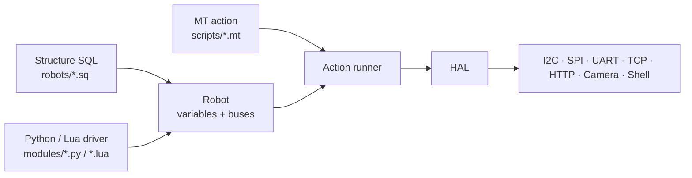

# pymybot

**A three-layer robot controller — structure SQL, Python/Lua drivers and MT action
scripts — with one backend for the GUI, CLI, AI agent and MCP.**

[中文 README](../README.md) · [Documentation](README.md) · [Roadmap](roadmap.md) · [Security](../.github/SECURITY.md)


> The screenshot shows the PySide6 window and the local loopback model: the agent
> lists hardware, runs a virtual action after approval, and brings the result back.

## Why we built it

Hardware projects rarely fail on the interesting part. They fail on the last mile:
which bus a sensor is on, which bytes initialize it, which script changes when the
board changes, and whether an action actually went out. Once you want an AI agent
in the loop, there is another question: what exactly did it touch, and what happens
if it fails halfway through?

pymybot puts that last mile in one place. You describe the robot in structure SQL,
write how one device works in Python or Lua, and describe what should happen in an
MT action script. Buses, permissions, approvals, receipts, logs, and the GUI, CLI,
agent and MCP front-ends all go through the same executor.

It is not meant to replace your application code. It is meant to own the part where
software has to touch real hardware safely.

## Four entry points

One backend, four ways in. Pick the one that fits the job; you do not need a
separate implementation for the desktop, CI and the model.

| Entry | Use it for | Command |
| --- | --- | --- |
| GUI | Desktop debugging, demos, per-tool approval | `pymybot` |
| CLI controller | CI/CD, scripts, no model required | `pymybot check / run / sample / ...` |
| AI agent | Natural-language robot control | `pymybot --no-gui --robot ... --task "..."` |
| MCP | Claude Desktop, Cursor and other MCP clients | `pymybot mcp --robot ...` |

A long-lived `serve` backend exposes the same session over stdio JSON-RPC 2.0 for
IDEs and custom front-ends. The MCP server is a read-only-by-default protocol
adapter over the same executor, so tool receipts, fault latching and serialization
rules do not change with the entry point. See [mcp.md](mcp.md).

## What we deliberately did not build

- **Three separate layers.** Structure, drivers and actions are written
  independently. Change a sensor without rewriting the action; change the action
  without touching the driver.
- **A requirement for real hardware.** Virtual buses, register models, the
  `loop://` serial loopback and per-driver fixtures let CI run the full chain
  without a board.
- **An open-by-default bridge.** Physical buses, non-loopback HTTP/TCP and the Shell
  driver require an explicit opt-in. HAL gates those entry points; the driver
  itself is trusted code, not a sandbox.
- **A shell that quietly drops its isolation.** Agent shell needs a usable
  bubblewrap with the prompt directories mounted read-only. If that cannot be set
  up — Windows included — it refuses to run instead of falling back to an
  unisolated workspace.
- **Actions as arbitrary code.** An action script is matrix data. Every dispatch,
  capture and result has a JSON receipt.
- **Pretending failures are clean.** If an exception happens after an action has
  been dispatched, the result is latched as “result unknown”. We do not claim a
  rollback, and a non-zero exit code is not reported as “not executed”.

## Quick start

Python 3.11+ is required. Start with the base install; no hardware is needed to run
the full chain.

```sh
git clone https://github.com/gopsc/mybot.git
cd mybot
python -m venv .venv
.venv/bin/pip install -e ".[test]"

.venv/bin/python -m pymybot --version
.venv/bin/python -m pymybot doctor

# No hardware required:
.venv/bin/python -m pymybot check \
  --robot robots/relay-test.sql \
  --input scripts/relay-test.mt
.venv/bin/python -m pymybot run \
  --robot robots/relay-test.sql \
  --input scripts/relay-test.mt --timeout 10

# GUI (PySide6 / Qt 6; optional for headless CLI use):
.venv/bin/pip install -e ".[gui]"
.venv/bin/python -m pymybot

# Agent:
.venv/bin/pip install -e ".[agent,test]"
export MYBOT_MODEL="deepseek:deepseek-chat"
export DEEPSEEK_API_KEY="sk-..."
.venv/bin/python -m pymybot --no-gui \
  --robot robots/relay-test.sql --task "List the hardware"
```

On Windows, use `.venv\Scripts\pip` and `.venv\Scripts\python`.

Agent conversations are transcribed to `~/.mybot/sessions` by default (tool
arguments, bounded results and images; API keys in environment variables are
never read into the transcript). Disable with `--no-session-log`,
`MYBOT_SESSION_LOG=0`, or the GUI settings toggle; list and prune with
`pymybot sessions [--prune --keep N --yes]`; see
[the CLI guide](cli.md#session-transcripts).

## Prompt layers

The agent's instructions live in `prompts/`: six Markdown layers ordered by
`manifest.json`. Layers 0 and 100 are the safety prefix and suffix, pinned to
hashes baked into the build — change one byte and validation fails. 10 is the
operator's core. 97, 98 and 99 are SOUL, USER and STATS, and those are the only
layers the model may touch, each time through a dedicated `prompt:update_prompt`
approval. Auto-approved actions or file writes do not cover it.

First use copies the defaults to `$MYBOT_HOME/prompts` (default
`~/.mybot/prompts`) without overwriting files you already changed. The composed
prompt is capped at 128 KiB. The status bar shows a short hash of the snapshot
actually used for the turn; 设置 → 提示词 lets you read the layers, edit 97/98/99,
refill missing files, or restore everything.

```sh
pymybot prompts list                     # no robot, no model
pymybot prompts restore --missing-only   # keep edits, fill gaps
pymybot prompts restore --all --yes      # back up first, then reset all layers
```

Without `--yes`, a full restore only asks on a terminal; scripts get a refusal.
Updates compare the previous hash, keep a backup, and record before/after hashes
and the reason in the audit trail — not the prompt text.
STATS is host-generated and sanitized — no arguments or secrets — and can be
turned off with `--no-prompt-stats`, the GUI toggle, or `autoStats: false` on
serve. `doctor` validates the bundled manifest and safety hashes without creating
your runtime directory.

## Design

Think of the three layers as a wiring diagram, a device manual and a run sheet.



- **Structure SQL** declares variables, buses, addresses and references.
- **Python / Lua drivers** implement `build / call`, with optional `read / destroy`,
  for one device family. Ordinary table names resolve to `modules/<Table>.py` or
  `.lua`. Roots are searched in order, Python before Lua within each root; an
  earlier root’s Lua still beats a later root’s Python. Repeat `--module-path DIR`
  to add roots.
- **MT actions** describe frames of parameters, captures and control flow.

Static commands never activate hardware. Physical devices, non-loopback HTTP/TCP and
the Shell driver require an explicit opt-in. HAL-backed drivers share the same
permission, handle-ownership and cancellation checks as Lua. Python drivers are
still trusted in-process code: imports and direct native I/O are unrestricted, and
budgets and cancellation are cooperative. See [security.md](security.md).

TCP also has a direct MT interface: [robots/tcp.sql](../robots/tcp.sql) declares only
`name`, `host` and `port`; [scripts/tcp.mt](../scripts/tcp.mt) uses `connect`, `close`,
`timeout`, `num_recv`, `send_hex`, `send_str`, `recv_hex` and `recv_str`. Activation
does not connect. Start a local TCP echo server before running the example;
text arguments use MT string expressions such as `$("hello")`.

For a complete runnable example, the Chinese README has a Python UART loopback
driver, structure SQL and action script that run without a board. The driver
contract is documented in
[`skills/pymybot-scripting/references/driver-lua.md`](../skills/pymybot-scripting/references/driver-lua.md).

## Documentation

Architecture, CLI, GUI, development, testing, release, versioning and security
guides live in [`docs/`](README.md). Scripting references live in
[`skills/pymybot-scripting/`](../skills/pymybot-scripting/SKILL.md).

## Contributing

Read [`CONTRIBUTING.md`](../.github/CONTRIBUTING.md). Use issues for
bugs/features, keep the default branch (`gui-mybot`, intended to become `main`)
the only long-lived branch, and never commit credentials.

## License

MIT — see [`LICENSE`](../LICENSE).
