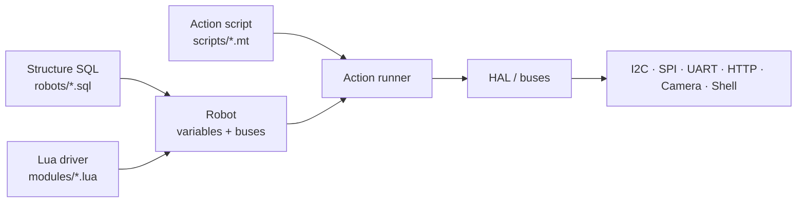
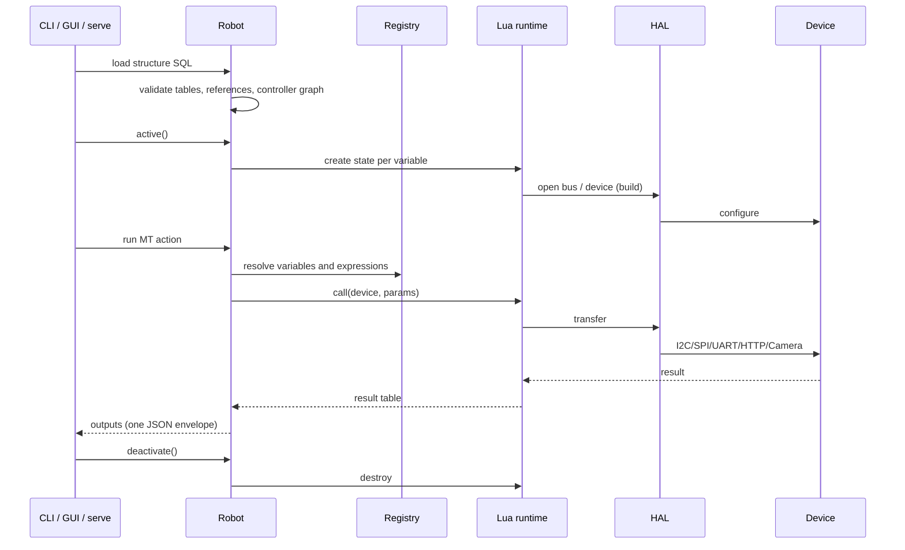

# Architecture

pymybot separates *what the robot is* from *how a part is driven* and *what
should happen over time*.

## Three layers

| Layer | File | Responsibility | Trust level |
| --- | --- | --- | --- |
| Structure | `robots/*.sql` | Declares variables, buses, addresses and controller links | Operator-authored |
| Driver | `modules/*.lua` | Implements build/call/destroy/read for one device family | Reviewed code |
| Action | `scripts/*.mt` | Matrices of device parameters, captures, loops and control flow | Operator-authored |

The robot is assembled from the SQL rows; each ordinary table maps to a
`modules/<table>.lua` driver. A row is a variable instance. `$name` references a
previously declared bus/controller, and `-` inherits the previous row's value.

## Runtime flow

Key invariants:

- The whole command emits exactly **one JSON line** on stdout. Diagnostics go
  to stderr; Lua `print` is redirected.
- `check`, `hardware`, `scripts` and `query` never activate drivers.
- `run`, `sample` and `apply-sql` activate the robot; activation itself may
  write to hardware.
- Driver calls are serialised per robot; daemon sampling uses dedicated worker
  threads with independent Lua states.
- An exception after an action starts is latched as “result unknown”; the
  runtime never claims a rollback.

## Python package map

| Module | Responsibility |
| --- | --- |
| `pymybot/cli.py` | Argument parsing, JSON contract, command dispatch |
| `pymybot/robot.py` | Structure loading, validation, activation, HMI |
| `pymybot/sql.py` | Strict in-memory SQL grammar and table operations |
| `pymybot/matrix.py` | MT action matrix parser and validator |
| `pymybot/actions.py` | Action runner: aliases, captures, control flow |
| `pymybot/expr.py` | Expression parser/evaluator and numeric rendering |
| `pymybot/runtime.py` | Lupa/LuaJIT bootstrap, sandbox hygiene, Python↔Lua conversion |
| `pymybot/hal.py` | I2C/SPI/UART/HTTP/Camera/Shell host operations |
| `pymybot/daemon.py` | Background sampling workers and snapshots |
| `pymybot/agent.py` | PydanticAI agent, model configuration, tool loop |
| `pymybot/agent_prompt.py` | Layered system prompt (SOUL/OPERATOR/PROJECT/GUIDE) with a byte budget |
| `pymybot/agent_context.py` | Bounded, mtime-cached project inventory injected as untrusted data |
| `pymybot/agent_intent.py` | Deterministic bilingual intent routing, tool allowlists and budgets |
| `pymybot/agent_executor.py` | Approval-gated tool implementations |
| `pymybot/agent_workspace.py` | Bounded, link-safe workspace file tools and shell |
| `pymybot/sandbox.py` | Shell sandbox backend probe and bubblewrap command builder |
| `pymybot/agent_web.py` | Bounded HTTPS fetch, SSRF guards and SearXNG search |
| `pymybot/serve.py` | Long-lived stdio JSON-RPC 2.0 backend |
| `pymybot/mcp_server.py` | Standard MCP stdio server over the same executor (read-only by default) |
| `pymybot/mcp_client.py` | Operator `mcpServers` configuration for external agent tools |
| `pymybot/gui/` | PySide6 front-end: protocol client, settings, approvals |
| `pymybot/security.py` | Bounded reads and strict JSON output |
| `pymybot/paths.py` | Source/frozen asset resolution |

## Entry points

- **GUI** never executes robot logic itself; it drives one `serve` child process
  and marshals all callbacks onto the Qt GUI thread.
- **Agent modes** execute tools through `RobotExecutor`, which runs hardware
  work on a dedicated owner thread and asks for approval through a callback.
  External MCP tools stay outside that owner thread and are surfaced by
  PydanticAI toolsets, but approval, result bounding and transcripts use the
  same session rules.
- **MCP server mode** is a protocol adapter over `RobotExecutor`: the model is
  absent, the operator passes static and execution switches at launch, and
  stdout carries only MCP JSON-RPC.
- **CLI controller mode** skips the model entirely and is suitable for CI.

## Asset and path resolution

Packaged assets live in `pymybot/assets/{modules,robots,scripts,skills}`. In a
source checkout the code falls back to the repository directories. Frozen
builds use `pymybot/paths.py` and `sys._MEIPASS`; never rely on the current
working directory. See [`development.md`](development.md) for the packaging
flow.

## Further reading

- [CLI reference](cli.md)
- [GUI guide](gui.md)
- [Security model](security.md)
- [Testing](testing.md)
- [Scripting reference](../skills/pymybot-scripting/SKILL.md)
