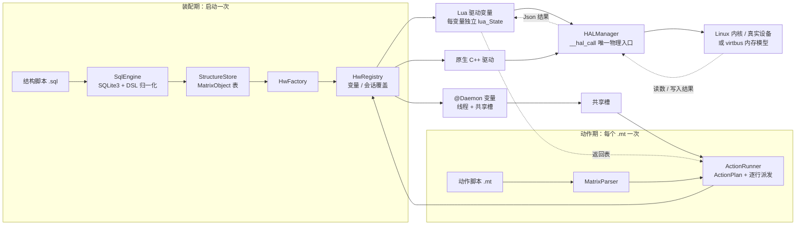
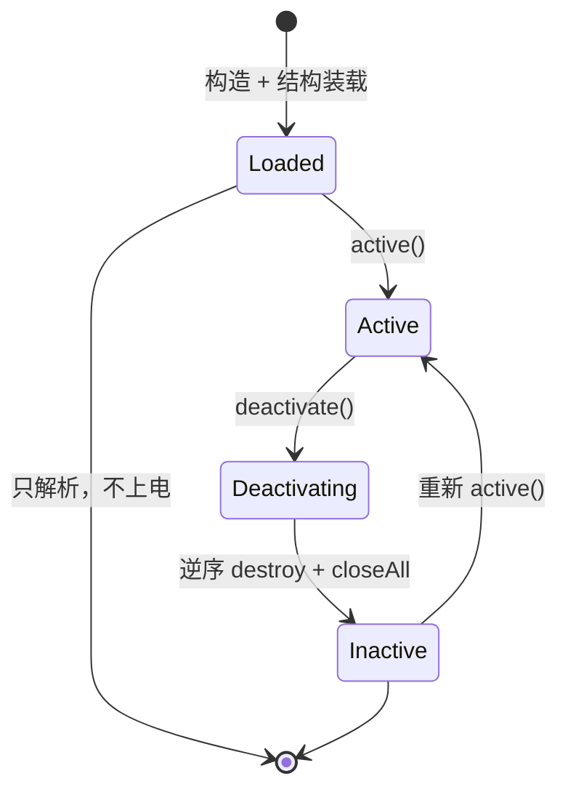
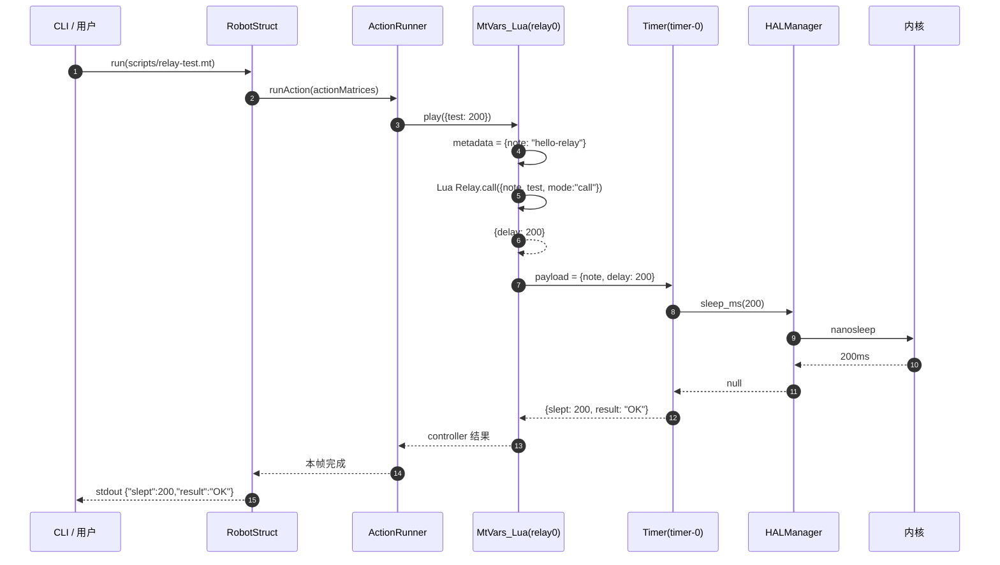
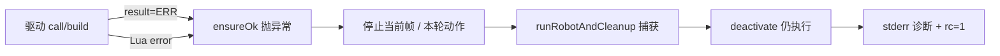
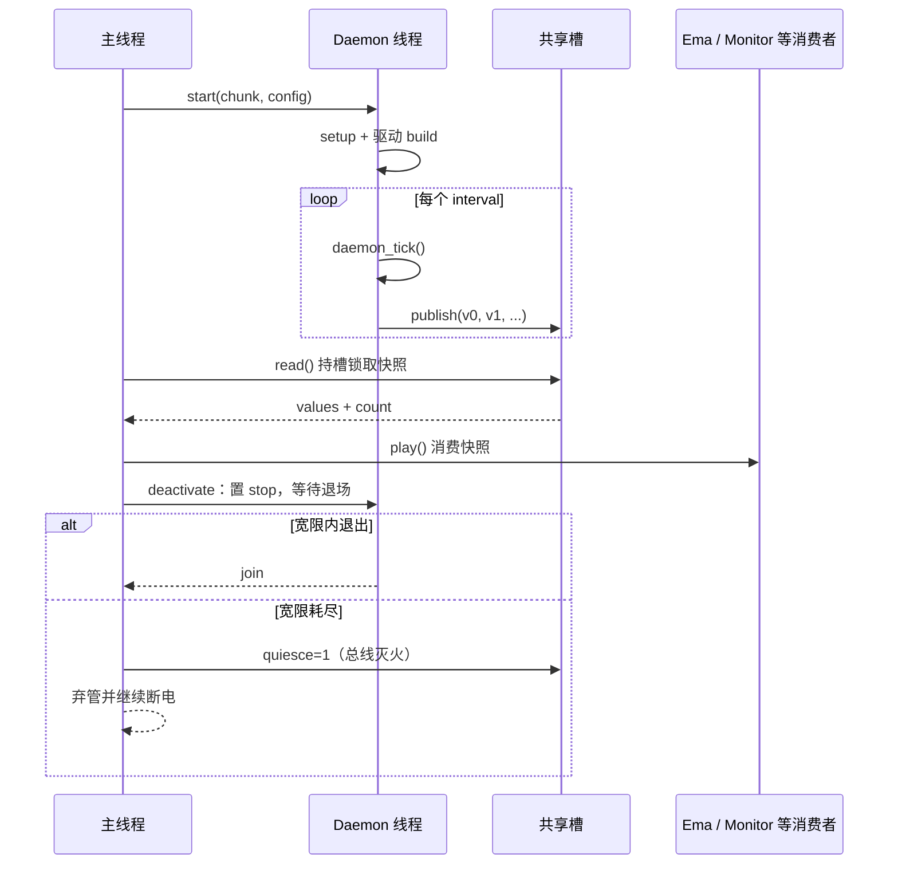
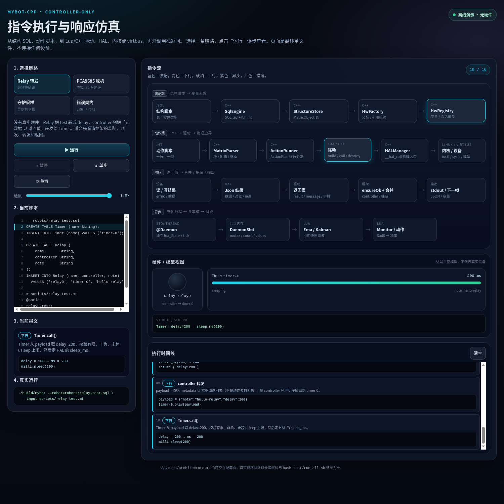

# 指令执行与响应架构

> 本文回答一个具体问题（对应 issue #62）：**一条结构声明、一行动作脚本，究竟怎样变成硬件上的读写；硬件的结果又怎样回到脚本、日志和下一帧动作。**
>
> 口径是当前 `controller-only` 分支（无 agent/MCP、无 Web SSH、无 3D 仿真器服务端）。历史快照 [architecture_analysis.html](architecture_analysis.html) 与两张 SVG 描述的是 2026-09-25 的两进程形态，已冻结；**现行口径以本文与各机制文档为准**。
>
> 想先看动画演示：直接用浏览器打开 [architecture_sim.html](architecture_sim.html)（单文件、离线、无外部依赖），可逐步播放 Relay 转发、PCA9685 写总线、守护采样和错误契约四条链路。

## 0. 一句话总览

```text
.sql 声明“机器人由哪些零件组成” → 装配成可执行的硬件变量
.mt  描述“每一拍让哪些零件做什么” → 逐行派发 play()
Lua/C++ 驱动把参数翻译成 HAL 调用 → 内核/设备
返回值沿调用栈逐层合并 → stdout / 捕获变量 / controller 转发 / 守护共享槽
```

三个关键事实：

1. **结构脚本不是运行期反复执行的 SQL**：它在启动期被 `SqlEngine` 解析成 `MatrixObject` 表，再装配成对象；运行期只派发对象，不再回读 SQL。`$var`、`$(expr)`、`-` 在结构阶段只作为文本保留，真正求值发生在装配期或动作期。
2. **动作脚本不是“逐行命令列表”**：一行是一帧，一帧可以同时驱动多个设备；列头决定“设备的哪个参数”，单元格决定值；设备按**首次出现顺序**派发。
3. **响应不是单一返回值**：同步调用有驱动返回表、controller 转发和捕获；异步采样有守护共享槽；失败有 `ERR` 契约与异常中止。四条路径的语义不同，不能混着看。

## 1. 全景图



对应代码入口：

| 层 | 入口 | 作用 |
| --- | --- | --- |
| 进程入口 | `src/main.cpp` | 解析 CLI、装载结构、安装信号处理器 |
| 结构装载 | `src/sql_engine.cpp` → `src/structure.cpp` | SQL → `MatrixObject` |
| 装配 | `src/hw_factory.cpp` → `src/hw_registry.cpp` | 表行 → 变量对象，登记引用关系 |
| 动作解析 | `src/matrix.cpp` → `src/action_runner.cpp` | `.mt` → 矩阵 → `ActionPlan` |
| 驱动执行 | `src/luavar.cpp` / `src/daemonconf.cpp` / `src/driver_*.cpp` | `build` / `play` / `destroy` |
| 物理边界 | `src/hal.cpp` + `modules/lib/HAL.lua` | I2C/SPI/UART/GPIO/PWM/TCP/HTTP/Shell/Speaker/FTDI/state |
| 仿真 | `modules/lib/virtbus.lua` + 各驱动尾部 `*_VIRT` | 无硬件复刻总线协议 |

## 2. 启动期：结构 SQL 如何变成硬件对象

### 2.1 从文件到矩阵

```text
--robot 路径
  → FileReader + LimitedReader（单文件 8 MiB 上限）
  → SqlEngine（自研词法器 + SQLite3 执行 + 读回）
  → StructureStore::deque<MatrixObject>
```

具体分四步：

1. **词法/语句校验**：`SqlEngine` 先识别 `CREATE TABLE` / `INSERT INTO`，校验表名是安全模块名（字母/数字/`_`/`-`，首字符字母或 `_`），拒绝 `/`、`\`、`.`、`..`、NUL；`Number` 列在解析期做数值字面量校验。
2. **交给 SQLite3 执行**：把结构 SQL 归一化成 SQLite3 能执行的语句，在内存库里建表、插行；这样列名/列序/重复列/缺值等语义直接复用 SQLite3。
3. **读回矩阵**：按 `CREATE` 声明序读回每张表；行 0 是列头，行 1..N 是实例。`$i2c-1`、`$(expr)`、`-` 在这条路径上**不做 SQL 求值**，原样保留为文本。
4. **落进 `StructureStore`**：容器是 `std::deque`，因为 `MetaProvider` 持有指向矩阵元素的引用，热插表追加时不能像 `vector` 那样让引用失效。

### 2.2 从矩阵到变量

`HwFactory::createHardVars()` 按声明序逐表分派：

| 表名/形态 | 产物 | 关键行为 |
| --- | --- | --- |
| `Alias` | `MtVars_Alias` | 参数名/设备名别名，文本标量 |
| `Vars` | `MtVars_Vars` | 命名数值，支持 `$(...)` 惰性求值 |
| `Daemon` | `MtVars_Daemon` + `DaemonRunner` | 独立线程 + 共享槽 |
| 原生驱动名（`Time`/`TCP`/`HTTP`/`Shell`/`Dev_enum`/`I2C_scan`/`LoopbackProbe`/`Nns`） | `MtVars_Native` | C++ 直接实现，不经过 Lua |
| 其他 | `MtVars_Lua` | 每行一个独立 `lua_State`，加载 `modules/<表名>.lua` |

装配前会做三类全局判据：

- **重名**：同名变量不能出现两次（`HwRegistry::add` 与 `HwFactory::precheckDuplicate` 用同一句报错）。
- **引用存在性与方向**：`controller`（出边）与 `trigger`（入边）指向的名字必须已声明；`$name` 引用必须指向非标量变量；引用关系登记进 `flowRefs_`，会话期别名覆盖不得触碰这些名字。
- **物理耦合**：`SINGLE_CONSUMER` 驱动按 `(总线路径, 归一化地址)` 唯一占用；同一物理串口被多个各自 `open` 的消费者声明时硬拒绝。

装配完成后，`RobotStruct::active()` 按声明序对每个变量调用一次 `build()`：

```text
active()
  → createHardVars()        # 先建对象，不碰硬件
  → metas_.validateAll()    # $ 引用/元数据检查
  → for hv in 声明序: hv->build()
```

`build()` 失败会让整个上电失败；析构/`deactivate()` 会兜底断电。

## 3. 生命周期状态机



- `Loaded`：结构已解析，变量对象已创建，但 `build()` 未执行。`run()` 允许在这个状态做**离线预演**；真实设备列会在派发时因未上电而失败（这是有意保留的校验能力，不是“假装上电”）。
- `Active`：所有变量 `build()` 成功，硬件可用。
- `Deactivating` / `Inactive`：先停守护、再逆序 `destroy()`、最后 `HALManager::closeAll()`；`run()` 在 `Inactive` 会被拒绝。

`deactivate()` 的顺序是硬约束：**守护屏障 → 驱动逆序 destroy → HAL 兜底关闭**。原因见 [daemon.md](daemon.md)：如果先断电再停守护，在途 tick 可能把执行器重新写回带电状态。

## 4. 动作期：一行 `.mt` 如何变成物理指令

### 4.1 解析与派发

```text
.mt 文件
  → mt::readMatrix()            # 块/表格/引号单元格/嵌套
  → mtinclude::expandIncludes() # @Include / @Merge 展开
  → 注册本次 run 的 @Alias/@Vars/@Struct（会话作用域）
  → ActionRunner::runAction()   # 找 Action 块
  → ActionPlan::build()         # 列头解析、别名/表达式求值、撞设备查重
  → dispatchMatrix()            # 逐行、逐设备 play()
```

一帧的派发核心在 `ActionRunner::dispatchMatrix()`：

1. **检查预算与停止标志**：`requireExecBudget()` / `stopRequested()`，每个动作行都过。
2. **解析本行单元格**：`-` 继承上一行；`$(...)` 求值；`$var=field` 识别为捕获格；普通数值/文本放进 `set`。
3. **按设备首次出现顺序派发**：`plan.order` 是列头中设备首次出现的顺序；同一设备的多个参数列合并成**一次** `play()`。
4. **调用 `hv->play(params)`**：Lua 驱动走 `MtVars_Lua::callImpl`，原生驱动走 `MtVars_Native`，守护变量走 `MtVars_Daemon::play`。
5. **契约检查**：`MatrixVars_Hardware::ensureOk(res)`——`result == "ERR"` 或返回值不是表，立即抛异常，停止本帧/本轮。
6. **捕获赋值**：本帧设备返回后，`$var=field` 从返回表按点号路径取值，写进 `@Vars`/`@Alias` 的会话覆盖层。

### 4.2 Lua 驱动的调用顺序

`MtVars_Lua::callImpl()` 的顺序很关键，很多“为什么参数没生效/为什么结果被覆盖”都能在这里找到答案：

```text
metadata = 结构列（字面列 + $引用列实时快照）
jsonMergeInto(obj, metadata)
jsonMergeInto(obj, @Action 本行参数)     # 动作参数覆盖同名元数据
mergeTriggerResults(obj)                 # 先跑 trigger 前置调用
obj.mode = "call"                        # 框架独占，最后写入
res = call_lua(L, obj)                   # 真正进入 Lua 驱动 call(data)
ensureOk(res)                            # ERR 即中止
if controller 列非空:
    payload = metadata ∪ res             # 注意：用原始 metadata，不是 obj
    controller->play(payload) 逐个转发
    返回最后一个 controller 的结果
else:
    返回 res
```

三个容易踩的点：

- **`mode` 在参数合并之后写入**：防止动作参数覆盖 `mode` 后让 `call_lua` 去 `getglobal` 一个外部可控的名字。
- **controller 转发用 `metadata ∪ res`，不是 `obj`**：动作参数不会原样透传给下游，避免上游动作键污染 controller 的入参。
- **trigger 结果以 trigger 名为键合并**：`trigger` 先于本驱动执行，返回值放进 `obj[triggerName]`；它和普通参数是两套来源。

### 4.3 一次完整下行/上行（Relay 示例）

结构脚本：

```sql
CREATE TABLE Timer (name String);
INSERT INTO Timer (name) VALUES ('timer-0');

CREATE TABLE Relay (name String, controller String, note String);
INSERT INTO Relay (name, controller, note)
  VALUES ('relay0', 'timer-0', 'hello-relay');
```

动作脚本：

```mt
@Action
relay0.test;
      200;
@
```

时序：



实际运行：

```sh
./build/mybot --robot=robots/relay-test.sql --input=scripts/relay-test.mt
# 输出：
# Relay: test=200 note=hello-relay -> delay=200
# {"slept":200,"result":"OK"}
```

这个例子里没有真实硬件，但除 HAL 的 `nanosleep` 外，**解析、装配、Lua 执行、controller 转发、返回契约全部是生产路径**。

### 4.4 有硬件时：以 PCA9685 为例

`robots/test/pca9685_virt.sql` 用 `proto=virt` 把 I2C 总线换成内存模型，但跑的是**真实** `modules/PCA9685.lua`：

```mt
@Action
pca-0.angle  t0.delay;
        90        50;
        45        50;
       135        50;
        90        50;
@
```

下行过程：

1. `PCA9685.call(data)` 从结构元数据取 `channel=0`，从动作参数取 `angle=90`。
2. `finite_of` 校验角度；钳位到 0..180；按 `0.5ms..2.5ms` 映射到 12 位计数：
   `width = 0.5 + 2.0 * angle / 180`，`offval = floor(width * 4096 / 20)`。
3. `i2c_write_multi(fd, 0x06, 0x00, 0x00, off_lo, off_hi)` 写通道 0 的 `LED0_ON_L/H` 四个字节。
4. `modules/lib/HAL.lua` 把参数归一化后调用宿主注入的 `__hal_call("i2c_transfer", ...)`。
5. `HALManager::opI2cTransfer()` 组装 `I2C_RDWR` 事务（写指针 + 读数据合并），经内核 `ioctl` 或 virtbus 模型完成。
6. 返回值 `{result:"OK"}` 沿原路返回 `ActionRunner`；`ensureOk` 通过后继续本帧的 `t0.delay`。
7. 每一帧的 stdout 是两段：PCA9685 的 `{"result":"OK"}` 和 Timer 的 `{"slept":50,"result":"OK"}`。

角度与寄存器值（实测）：

| angle | width (ms) | offval (dec) | offval (hex) | 写入 0x06 的 4 字节 |
| --- | --- | --- | --- | --- |
| 90 | 1.5 | 307 | 0x0133 | `00 00 33 01` |
| 45 | 1.0 | 204 | 0x00CC | `00 00 CC 00` |
| 135 | 2.0 | 409 | 0x0199 | `00 00 99 01` |

`proto=virt` 时这些事务由 `PCA9685_VIRT` 模型校验（模式寄存器、PRESCALE、地址自增、通道范围）；真机时同一份驱动代码走真实 `I2C_RDWR`。这就是“仿真不是另一套实现”的含义。

## 5. 响应路径：返回值到底去了哪里

### 5.1 四类响应

| 响应形态 | 产生位置 | 消费方 | 语义 |
| --- | --- | --- | --- |
| 驱动返回表 | Lua `call()` / 原生驱动 | `ActionRunner` → stdout | 同步结果；`result=ERR` 即中止 |
| controller 转发结果 | `MtVars_Lua::forwardToControllers` | 下游驱动 | 元数据 ∪ 本驱动返回表，按 controller 列声明序扇出 |
| 捕获 `$var=field` | `ActionRunner::applyCapture` | `@Vars`/`@Alias` 会话层 | 把本帧返回值写进变量，供后续帧/块使用 |
| 守护共享槽 | `DaemonRunner` + `pthread.lua` | `$daemon` 引用 / `MtVars_Daemon::read` | 异步采样快照，加锁读，不阻塞主线程 |

### 5.2 返回契约

所有硬件变量必须返回一个**表**，至少带 `result`：

```json
{"result":"OK","slept":200}
```

- `result` 不是 `"OK"`（trim 后）→ `ensureOk` 抛异常。
- 返回值不是表 → 同样抛异常（“没动”不能伪装成成功）。
- `ERR` 表可以带 `message`，但异常文案会带上下文（哪一行、哪个变量、哪次调用）。
- `destroy()` 的 `ERR` 在停机路径只告警，不阻止后续变量断电（尽力释放）。

### 5.3 错误传播



`--timeout` 的预算错误（`ExecBudgetExceeded`）走同一条链，但文案带“动作脚本执行预算”标记；HAL 不会把它折成 `-1`/`null`，否则 Lua 驱动只会看到一次普通失败。

### 5.4 异步响应：守护线程



要点：

- 每个守护是**独立线程 + 独立 `lua_State`**，LuaJIT VM 不跨线程共享。
- 采样值写进 `DaemonSlot`（ABI v2：`mutex/count/nvals/values*/capacity/stop/status/quiesce`），主线程 `read()` 持同一把槽锁读快照。
- `stop` 是“请退出”，`quiesce` 是“物理隔离”：宽限内退场的守护还要跑 `daemon_cleanup`，传输必须放行；只有确定要与硬件销毁并发的弃管者才置 `quiesce`。
- 守护 setup 失败把负状态码写进 `status`，消费方读到非 0 即抛错；不会把失败伪装成 `v0=-1` 的样本。

## 6. 热 SQL：运行中改结构

热 SQL 不是“重新执行整个结构脚本”，而是一个**事务型增量变更**：

```text
applySql(sql)
  → HotSqlPlanner 解析/校验（表名、引用、单消费者、模块路径、Nns 路径…）
  → 合并视图上复跑全结构判据
  → INSERT：装配新变量 → build → 注册；失败逆序 destroy + 回滚
  → DELETE：预检引用完整性 → 逆序 destroy → 摘注册/矩阵行
  → DROP：全表 DELETE + 摘表壳 + 元数据提供者重锚定
  → UPDATE：预检 → 先断电摘除 → 按新值重建（失败窗口如实报告）
  → 返回人读摘要
```

热 SQL 的入口按**不可信输入**处理：`Daemon.chunk` 只接受模块根下已存在的相对路径；`Nns.path` 只接受模型根下相对路径；`layers` 有层数/单层/总参数上限。启动期结构脚本仍按可信本地文件处理（见 [reference.md](reference.md) 的信任模型）。热 SQL 内的瞬态 `Action` 在 30s 墙钟预算下执行（`kHotSqlActionBudgetMs`）：超时按 `ExecBudgetExceeded` 中止并回滚本批次硬件，不能借 `Timer` 等路径把 `applySql` 拖成长时间阻塞。

## 7. 仿真：无硬件时到底仿真了什么

交互页截图（Relay 转发链路的第 10 步：controller 已转发，Timer 正在 HAL 里睡 200ms）：



controller-only 有两条“无硬件”路径，语义不同：

| 路径 | 做法 | 运行的是 | 适合 |
| --- | --- | --- | --- |
| 纯软件模块 | `Relay`/`dummy`/`Timer` 等 | 真实 Lua 驱动，不碰 HAL 总线 | 链路自检、文档示例 |
| `virtbus` 虚拟总线 | `proto=virt` + 驱动内嵌 `*_VIRT` 模型 | **真实驱动代码** + 内存版器件协议 | 无硬件 E2E、写路径/读路径回归 |

`virtbus` 的关键设计：

- 驱动在 `arg_table`（或 `require_driver` 框架）里先做 `virt_prepare`，由它加载 `lib/virtbus.lua` 并挂载模型；之后 `i2c_open` 返回虚拟 fd，所有 `i2c_*` / `spi_*` / `uart_*` 调用进入模型而不是内核。
- 模型逐事务校验寄存器/位域/读写时序，返回与真机一致的失败形态；驱动以为自己在跟真器件说话。
- 非守护路径（`@Action` 直接驱动舵机/DAC）和守护路径（`sensor_daemon`）都支持。
- 启动会打印 `VIRTUAL HARDWARE -- NO REAL DEVICE` 横幅，防止把仿真结果误当生产数据。

可直接跑的例子：

```sh
# 纯软件：Relay → Timer
./build/mybot --robot=robots/relay-test.sql --input=scripts/relay-test.mt

# 虚拟 I2C 写路径：真实 PCA9685 驱动 + 内存模型
./build/mybot --robot=robots/test/pca9685_virt.sql \
              --input=scripts/test/pca9685_virt.mt

# 虚拟守护采样：ADS1015 → 共享槽 → Ema → Monitor
./build/mybot --robot=robots/test/ads1015_virt.sql \
              --input=scripts/test/ads1015_virt.mt

# 负值契约：channel=17 在下发总线前报错，rc=1
./build/mybot --robot=robots/test/pca9685_badchan.sql \
              --input=scripts/test/pca9685_badchan.mt
```

> **3D 仿真器**（`sim/` + `modules/Sim.lua`）不在 controller-only 分支：它需要 GLFW/OpenGL，且本分支已移除 `sim/` 服务端。历史协议与运行方式见 [sim.md](sim.md)，仅作存档。本文配套的 [architecture_sim.html](architecture_sim.html) 则是**纯浏览器**的指令流演示，不需要构建、不会碰任何设备。

## 8. 安全与实时性边界

### 8.1 信任边界

- 结构脚本/动作脚本落盘前只是数据；**驱动文件是任意原生代码执行入口**。
- Lua 沙箱中和了 shell/文件 I/O，但驱动仍可 `require("ffi")` 直调 libc；沙箱是防误用护栏，不是对抗恶意输入的安全边界。
- 结构表名被限制为安全模块名；`@Daemon.chunk` 与热 SQL 的模型路径被限制在模块/模型根内。
- 物理 I2C/SPI/UART、非回环 HTTP/TCP、Shell 默认允许；需要对抗不可信输入源时应在进程外隔离。

### 8.2 `--timeout` 能保证什么

`--timeout` 是**整轮动作的墙钟预算**，不是硬实时中断：

- Lua 指令钩子、`ActionRunner` 行/块循环、HAL 的 `sleep_ms`/UART/TCP/HTTP/Shell/Speaker 都会检查预算。
- 阻塞在不可中断 ioctl（如 D 态）或 C 扩展内部时，用户态没有检查点；预算不能强行打断。
- 首次 SIGINT/SIGTERM 只置停止标志，让正常清理链执行；第二次才是强杀逃生口。

## 9. 代码地图

| 想改什么 | 先看哪里 |
| --- | --- |
| 结构 SQL 语法/列校验 | `src/sql_engine.cpp`、`src/scriptlimit.hpp` |
| MT 解析/块嵌套/引号单元格 | `src/matrix.cpp`、`src/matrix.hpp` |
| 表达式/别名/捕获 | `src/expr.cpp`、`src/action_runner.cpp` |
| 装配/引用/单消费者 | `src/hw_factory.cpp`、`src/hw_registry.cpp` |
| Lua 驱动桥/沙箱 | `src/luavar.cpp`、`src/luasandbox.cpp`、`src/luabridge.cpp` |
| 守护/共享槽/停机 | `src/daemonvar.cpp`、`src/daemonconf.cpp`、`modules/lib/pthread.lua` |
| HAL/总线 | `src/hal.cpp`、`modules/lib/HAL.lua`、`modules/lib/hal/*.lua` |
| 热 SQL | `src/hotsql_plan.cpp`、`src/hotsql_service.cpp` |
| 原生驱动 | `src/driver_*.cpp`、`src/native_registry.cpp` |
| 驱动契约 | [drivers.md](drivers.md) |
| 虚拟总线 | [virtbus.md](virtbus.md) |

## 10. 相关文档

- [DSL 参考](dsl.md)：结构 SQL、动作块、`@Alias`/`@Vars`/`@Struct`/`@Merge`/`@Include` 的完整语法。
- [驱动清单与契约](drivers.md)：`build`/`call`/`destroy`、返回值、`SINGLE_CONSUMER`、内嵌 `*_VIRT`。
- [HAL](hal.md)：C++ HAL 与独立 LuaJIT 回退路径、总线语义、沙箱、执行预算。
- [守护线程](daemon.md)：共享槽 ABI、`sensor_daemon`、多守护聚合、停机屏障。
- [虚拟总线](virtbus.md)：模型库、注入机制、回归清单。
- [命令行与环境变量](reference.md)：CLI、`BOT4CJ_*`、信任模型。
- [可交互指令流仿真](architecture_sim.html)：本文四条链路的逐步动画版。
