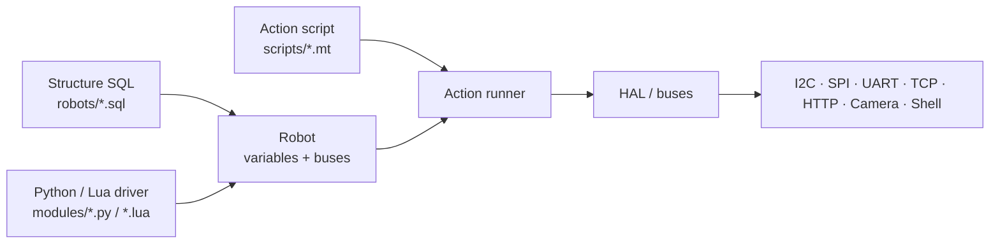
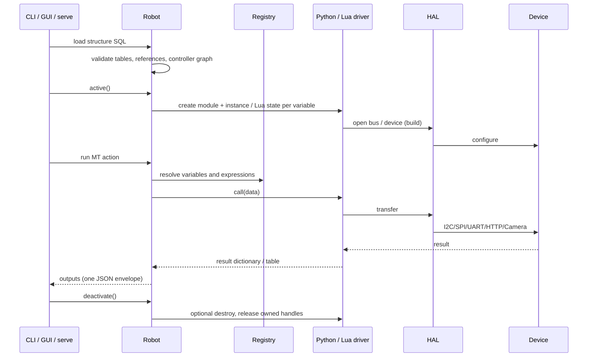
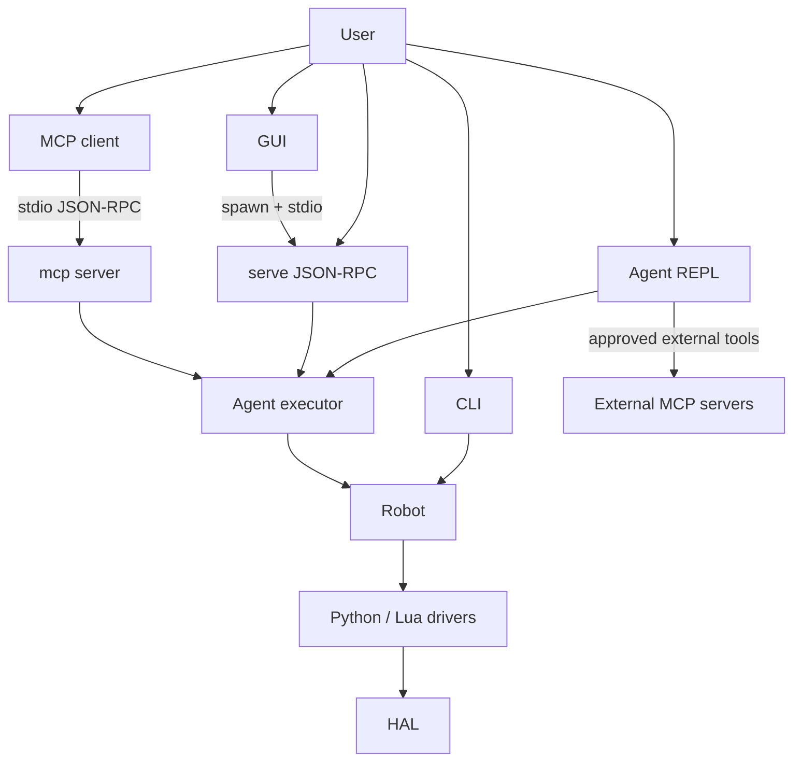

# Architecture

pymybot separates *what the robot is* from *how a part is driven* and *what
should happen over time*.

## Three layers

| Layer | File | Responsibility | Trust level |
| --- | --- | --- | --- |
| Structure | `robots/*.sql` | Declares variables, buses, addresses and controller links | Operator-authored |
| Driver | `modules/*.py` / `*.lua` | Implements build/call and optional read/destroy | Trusted in-process code |
| Action | `scripts/*.mt` | Matrices of device parameters, captures, loops and control flow | Operator-authored |

Each ordinary SQL table selects `<Table>.py` or `<Table>.lua` from the configured
module roots (`--module-path`, repeatable). Roots are searched in order, **Python
before Lua within each root**; an earlier root's Lua beats a later root's Python.
`Alias`, `Vars` and `Daemon` retain their special handling. A row is a variable
instance. `$name` references a previously declared bus/controller, and `-`
inherits the previous row's value.

## Native Python contract

Activation executes the selected source in a fresh module namespace and creates
one `Driver(context)` instance **per SQL row**. `build(data)` and `call(data)` are
required; `read(data)` is optional and falls back to `call(data)`, and optional
`destroy(data)` performs cleanup. Methods receive a dictionary of resolved
metadata, action parameters and trigger results as applicable, with `mode` set
to the entry point. Return a nonempty dictionary of JSON-compatible values;
`result` may be omitted, or be `"OK"` for success / `"ERR"` with `message` for failure.

`context.call(operation, *args)` uses existing HAL operations (for example,
`uart_read`, `i2c_transfer`, `close_handle`) with the same permissions, handle
ownership/cleanup and cancellation checks as Lua's HAL bridge. These are host
operation names, not the Lua convenience helpers. `context.check()` checks the
cooperative budget. Python is trusted, **not sandboxed**: imports and direct
native I/O are unrestricted; neither blocking native calls nor uncooperative
Python loops can be forcibly interrupted. Per-row module/instance isolation is
not process isolation; imported packages may share state.

The built-in I2C/SPI/UART/TCP/HTTP/Camera/Shell ordinary-table drivers use Python.
TCP declares only name/host/port; activation validates without connecting, and MT
explicitly controls connect/close, timeout/num_recv and hexadecimal/UTF-8 I/O.
Each TCP row opens its own stream; no endpoint-level connection sharing or replay.
HAL-backed buses expose the existing HAL handles to Lua device drivers rather
than creating a separate bus backend. Python I2C/SPI/UART drivers open buses
with `proto=virt` or a `virt-*` path as in-memory HAL handles with physical
access disabled, including legacy device-looking paths under explicit
`proto=virt`; they never fall back to physical hardware.
Lua device drivers retain their existing `virtbus` models and per-runtime
isolation. Other Python drivers do not automatically gain Lua virtual models.
Existing Daemon chunks remain Lua-only; static validation rejects a
Python-selected `driver` or `devices` entry rather than silently selecting a
different source.

## Runtime flow

Key invariants:

- The whole command emits exactly **one JSON line** on stdout. Diagnostics go
  to stderr; Lua `print` and the Python driver's default `print` are redirected.
  Trusted Python code must keep direct/imported-library output off stdout too.
- `check`, `hardware`, `scripts` and `query` never activate drivers. Python
  source is compiled without execution; imports, constructors and method
  availability are not validated by this static check.
- `run`, `sample` and `apply-sql` activate the robot; activation itself may
  write to hardware.
- Driver calls are serialised per robot; daemon sampling uses dedicated worker
  threads with independent Lua states.
- An exception after an action starts is latched as “result unknown”; the
  runtime never claims a rollback.

## Python package map

| Module | Responsibility |
| --- | --- |
| `pymybot/cli.py` | Argument parsing, JSON contract, command dispatch |
| `pymybot/robot.py` | Structure loading, validation, activation, HMI |
| `pymybot/sql.py` | Strict in-memory SQL grammar and table operations |
| `pymybot/matrix.py` | MT action matrix parser and validator |
| `pymybot/actions.py` | Action runner: aliases, captures, control flow |
| `pymybot/expr.py` | Expression parser/evaluator and numeric rendering |
| `pymybot/runtime.py` | Shared HAL bridge, Lupa/LuaJIT bootstrap and Python↔Lua conversion |
| `pymybot/native.py` | Compile-only validation, per-row Python modules, Driver context and results |
| `pymybot/hal.py` | I2C/SPI/UART/HTTP/Camera/Shell host operations |
| `pymybot/daemon.py` | Background Lua sampling workers and snapshots |
| `pymybot/agent.py` | PydanticAI agent, model configuration, tool loop |
| `pymybot/prompts.py` | Manifest-ordered runtime prompt layers, trusted safety hashes, bounded composition, CAS/backups and private storage |
| `pymybot/roles.py` | Role creation/loading, role-owned prompt/skills/MCP paths and bounded atomic model-history persistence |
| `pymybot/agent_prompt.py` | Operator profile validation and legacy prompt composition compatibility |
| `pymybot/agent_context.py` | Bounded, mtime-cached project inventory injected as untrusted data |
| `pymybot/agent_intent.py` | Deterministic bilingual intent routing, tool allowlists and budgets |
| `pymybot/agent_executor.py` | Approval-gated tool implementations |
| `pymybot/agent_workspace.py` | Bounded, link-safe workspace file tools and shell |
| `pymybot/sandbox.py` | Shell sandbox backend probe and bubblewrap command builder |
| `pymybot/agent_web.py` | Bounded HTTPS fetch, SSRF guards and SearXNG search |
| `pymybot/serve.py` | Long-lived stdio JSON-RPC 2.0 backend |
| `pymybot/mcp_server.py` | Standard MCP stdio server over the same executor (read-only by default) |
| `pymybot/mcp_client.py` | Operator `mcpServers` configuration for external agent tools |
| `pymybot/gui/` | PySide6 front-end: protocol client, settings, approvals |
| `pymybot/security.py` | Bounded reads and strict JSON output |
| `pymybot/paths.py` | Source/frozen asset resolution |

## Entry points

- **GUI** never executes robot logic itself; it drives one `serve` child process
  and marshals all callbacks onto the Qt GUI thread.
- **Agent modes** execute tools through `RobotExecutor`, which runs hardware
  work on a dedicated owner thread and asks for approval through a callback.
  An optional role under `~/.mybot/roles` supplies the session's PromptLibrary,
  Skills, MCP configuration and resumable model history; it does not change
  hardware ownership or approval boundaries.
  External MCP tools stay outside that owner thread and are surfaced by
  PydanticAI toolsets, but approval, result bounding and transcripts use the
  same session rules.
- **MCP server mode** is a protocol adapter over `RobotExecutor`: the model is
  absent, the operator passes static and execution switches at launch, and
  stdout carries only MCP JSON-RPC.
- **CLI controller mode** skips the model entirely and is suitable for CI.

## Asset and path resolution

Packaged assets live in `pymybot/assets/{modules,robots,scripts,skills,prompts}`; module
assets include both `.py` and `.lua`. Doctor counts both; agent inventory and
GUI previews include both within their existing budgets, with Python syntax
highlighting for `.py`. In a source checkout the code falls back to the
repository directories. Frozen builds use `pymybot/paths.py` and `sys._MEIPASS`;
never rely on the current working directory. See [`development.md`](development.md)
for the packaging flow.

## Further reading

- [CLI reference](cli.md)
- [GUI guide](gui.md)
- [Security model](security.md)
- [Testing](testing.md)
- [Scripting reference](../skills/pymybot-scripting/SKILL.md)
