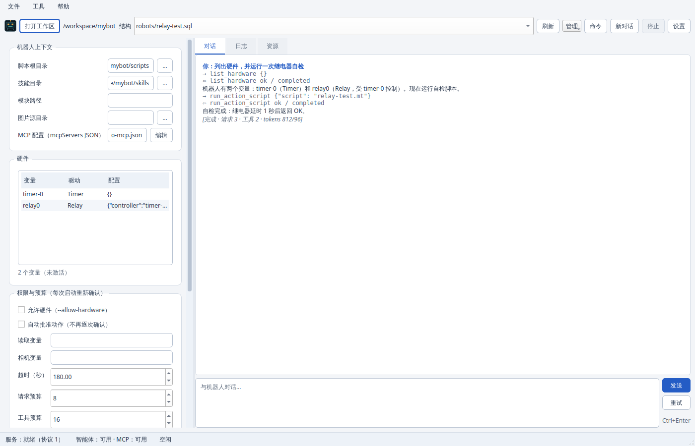

# GUI guide

The PySide6 (Qt 6) GUI is the default entry point for the Python reference edition:

```sh
pymybot            # opens the window
pymybot --no-gui   # terminal interface
```



## What the window contains

- **Toolbar** — workspace picker, structure SQL selector, refresh, new
  conversation, stop and settings.
- **Robot context** — scripts root, skills directory, module path and image
  source directory.
- **Hardware tree** — variables, driver type and configured metadata, read from
  the selected structure without activating devices.
- **Permissions and budgets** — allow hardware, auto-approve actions, read
  variables, camera variables, timeout/model-request/tool-call budgets.
- **Model summary** — current provider/model/endpoint/key-variable state.
- **Chat and logs** — agent transcript, tool calls, errors, and a separate
  diagnostics log tab.
- **Status bar** — serve state, agent availability, busy state and notices.

## First run

1. Install the GUI and agent dependencies (CLI-only environments can omit `gui`):

   ```sh
   python -m pip install -e ".[gui,agent]"
   ```

2. Open **设置** and choose:
   - the Python interpreter (leave empty to use the workspace `.venv` or the
     bundled interpreter);
   - the model, e.g. `openai:gpt-4o`, `openai-chat:my-model`,
     `anthropic:claude-sonnet-4-5` or `deepseek:deepseek-chat`;
   - the base URL only when using a self-hosted OpenAI-compatible endpoint;
   - the **name** of the environment variable holding the API key. The key
     itself is never stored in the settings file;
   - optional **变量覆盖** (`NAME=VALUE`, one per line) for structure
     `Alias`/`Vars` rows. They are applied before activation, passed to every
     agent action, kept in memory for this launch only, and never written to
     the settings file;
   - whether **保存会话转录** is enabled. It is on by default; turning it off
     starts `serve` with `--no-session-log`. `MYBOT_SESSION_LOG=0` in the
     environment still disables transcripts regardless of this checkbox. Use
     `pymybot sessions` to inspect or prune existing transcripts.

3. Pick the workspace and a `robots/*.sql` structure. The hardware tree and
   model summary update immediately.

4. Type a task. Tool calls that can move hardware, write files or run shell
   commands show a confirmation dialog; closing the dialog means deny.

## Approval model

| Toggle | Effect |
| --- | --- |
| 允许硬件 | Opens physical devices / non-loopback HTTP / Shell driver. |
| 自动批准动作 | Pre-approves action scripts, variable reads and captures for this session. |

File writes and shell execution are **not** exposed by the GUI. Use
`--no-gui --workspace-dir DIR --enable-shell` for those tools, where each
write/command needs its own confirmation. The GUI intentionally keeps the
surface small.

Permissions and the one-shot task are **not persisted**; every launch starts
closed. Workspace, model and budgets are persisted in the per-user settings
file (see below).

## Settings file

| OS | Location |
| --- | --- |
| Windows | `%APPDATA%\pymybot-gui\settings.json` |
| macOS | `~/Library/Application Support/pymybot-gui/settings.json` |
| Linux | `$XDG_CONFIG_HOME/pymybot-gui/settings.json` or `~/.config/pymybot-gui/settings.json` |

Only preferences are stored. API keys, variable override values, approval
decisions and hardware permissions are never written. A failed write is reported in the log and status
bar instead of failing silently.

## Architecture

The window owns no robot logic. It launches one long-lived
`python -m pymybot serve` child and speaks stdio JSON-RPC 2.0 to it. All reader
callbacks are dispatched to the Qt GUI thread. This keeps the UI responsive
during model streaming and hardware work.

Frozen Windows builds prefer the sibling `pymybot.exe` for the `serve` child;
the GUI executable itself has no console. See
[`development.md`](development.md#frozen-builds).

## Troubleshooting

| Symptom | Fix |
| --- | --- |
| “智能体不可用” | Install `.[agent]`; check the interpreter selected in settings. |
| Window opens but no model | Set `MYBOT_MODEL`/API key or configure them in settings. |
| Camera fails on Windows | Close other apps using the camera; some devices require running the app as administrator. |
| “启动中…” forever | Fixed in 0.2.0. On older builds, restart the window. |
| Missing PySide6 | Install `pymybot[gui]` (source checkout: `pip install -e '.[gui]'`). |
| No desktop display | Use `pymybot --no-gui` on headless Linux. |
| Qt xcb platform plugin cannot load | Install your distribution's Qt/X11 runtime libraries, including `libxcb-cursor0` on Debian/Ubuntu. |

## Limitations

- No file tree/editor, sampling curves or conversation history browser.
- One serve child per window; a restart briefly tears down the hardware session.
- The GUI is a front-end, not a sandbox. The same trust rules as the CLI apply.
