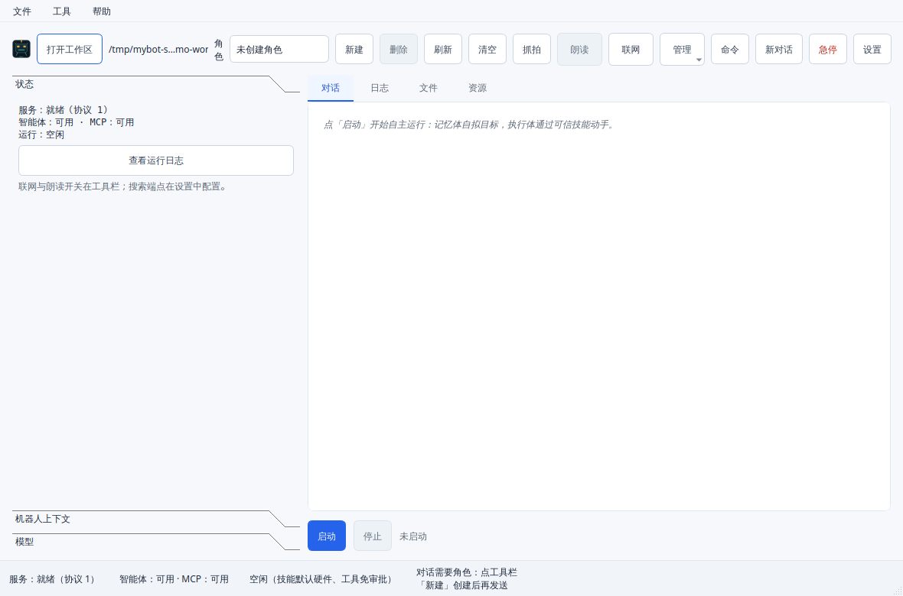
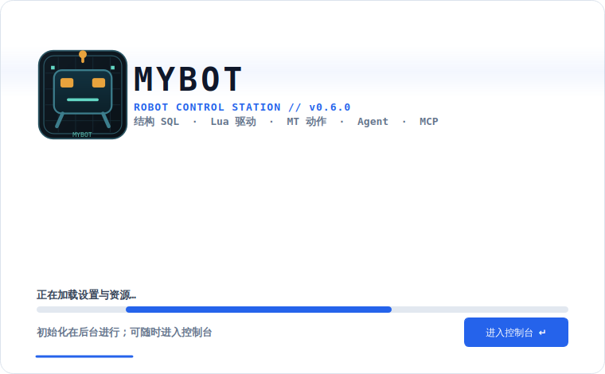
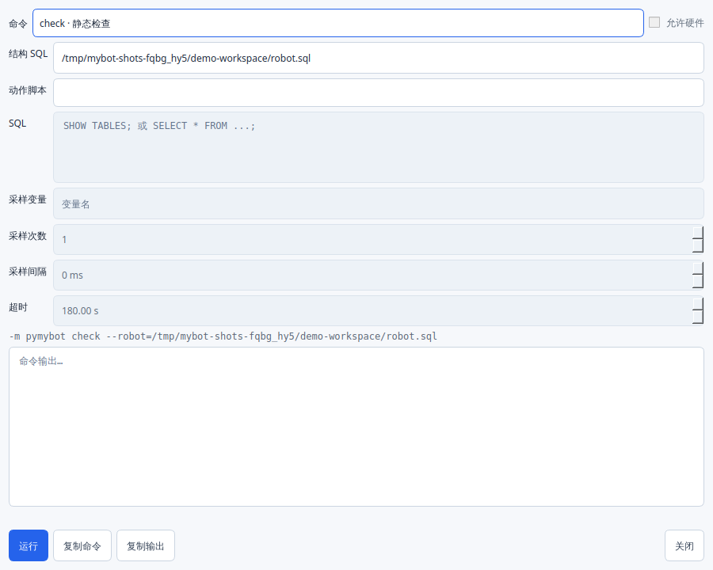
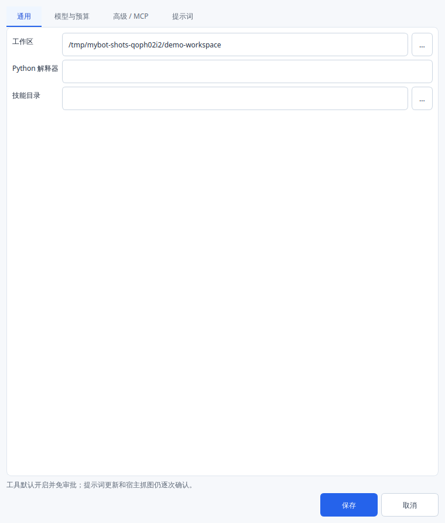
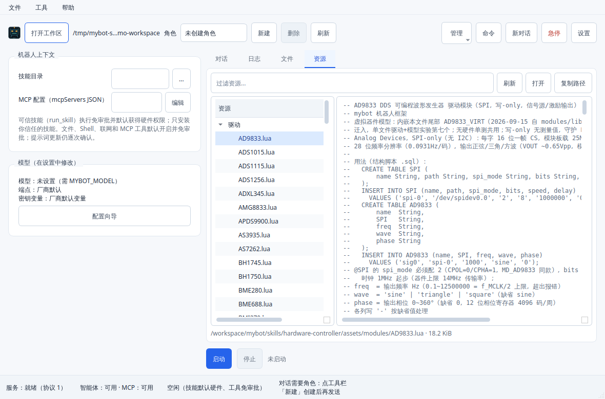
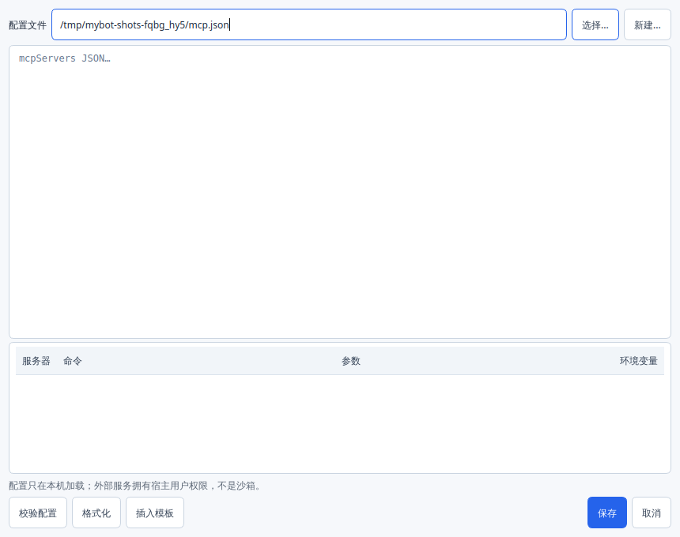
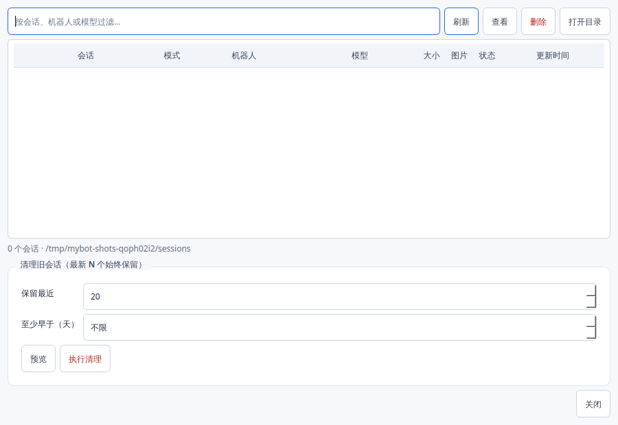
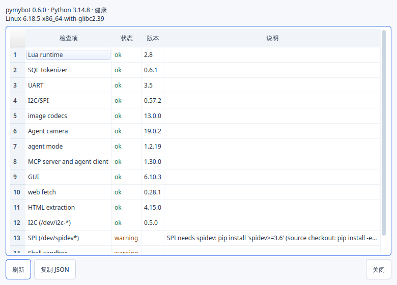

# GUI guide

The PySide6 (Qt 6) GUI is the default entry point:

```sh
pymybot            # opens the window
pymybot --no-gui   # terminal interface
```



## Entry screen

The default launch shows a frameless retro entry screen while the window and
its `serve` child initialise:

- SVG robot logo, monospace wordmark, moving scan line and an indeterminate
  progress bar (Qt animations, no video or timer-only fake stages);
- live status from the real `serve` lifecycle (`启动中…`, `就绪（协议 1）`,
  `启动失败…`), not a scripted percentage;
- **进入控制台** button, `Enter` shortcut and `Escape` cancel; the main window
  fades in with a 280 ms `windowOpacity` animation;
- `pymybot --no-splash` or `MYBOT_GUI_SPLASH=0` opens the window immediately
  (used by automated GUI tests).

The main window's logo is the same SVG; it is also the window icon and the
About dialog mark.

## What the window contains

- **Menu bar** — 文件 (workspace, structure, refresh, settings, quit),
  工具 (MCP editor, sessions, diagnostics, resources, session folder, clear/copy
  chat) and 帮助 (docs, about). Every entry has a shortcut.
- **Toolbar** — workspace picker, Agent role selector/create, structure SQL
  selector, refresh, a 管理 menu, new conversation, stop and settings.
- **Robot context** — skills directory and MCP configuration. The agent lists
  and captures host cameras with the built-in `list_cameras` / `capture_camera`
  tools; cameras are not declared in the structure.
- **Capability and budgets** — read variables, timeout, model-request,
  tool-call and history budgets.
- **Model summary** — current provider/model/endpoint/key-variable state.
- **Chat, logs and resources** — streaming transcript, tool receipts,
  diagnostics, and a lazy resource browser for scripts, skills and docs.
- **Status bar** — serve/MCP availability, busy state with an indeterminate
  progress indicator, active grants and notices.

## Management console

The GUI exposes the backend surface described in [cli.md](cli.md) and
[mcp.md](mcp.md); it does not duplicate robot logic.

| Entry | What it does |
| --- | --- |
| 设置 | Tabs for 通用 / 模型与预算 / 高级 / MCP / 提示词: interpreter, model endpoint/key variable, timeout, request/tool/history budgets, project-context budget, intent routing, Shell sandbox backend, transcript switch, MCP file, SearXNG endpoint and the operator prompt file. The 意图路由 dropdown mirrors `--intent`; the status bar shows the active intent and confidence after each turn. |
| 工具 → 命令面板 | Exposes `check`, `hardware`, `scripts`, `query`, `run`, `sample`, `apply-sql`, `doctor` and `sessions` with dynamic fields, an argv preview, hardware confirmation and the JSON result. It builds argv with the same helper as the GUI's hardware call. |
| 工具 → MCP 配置 | JSON editor with syntax highlighting, the same `mcpServers` validator as the agent, a server table (environment values hidden), template insertion, formatting and atomic save. |
| 工具 → 会话管理 | Newest-first transcript table with filtering, transcript preview, per-session delete, dry-run/execute pruning, and a folder shortcut. |
| 工具 → 环境诊断 | Renders `pymybot doctor`: interpreter, assets and optional dependencies, colour-coded by status, with copy-JSON. |
| 资源 tab | Structures (`*.sql`), Python/Lua drivers, scripts, skills and source-tree docs in a filterable tree; Markdown is rendered with Qt's Markdown engine, code uses a keyword/comment highlighter. Content is cached by mtime, a `QFileSystemWatcher` debounces reloads, and previews fade in with `QPropertyAnimation`. |
| 停止对话 / 急停 | **停止对话** cancels the running Agent turn. **急停** has no confirmation dialog: it sends `abort`, cancels the turn, calls driver `safe()` hooks and releases hardware. It is best-effort, not a hardware emergency stop. |
| 重试 | Re-sends the last task after an error, cancellation or timeout, disabled while a turn is running. |
| 清空 / 复制对话 | Clear the window transcript (after confirmation) or copy it to the clipboard. |
| 打开会话目录 | Opens `~/.mybot/sessions` in the file manager. |

Loading is incremental: the resource list and transcripts load on
demand or in background threads; stale results are discarded by generation
counters; resource reads are cached until the file changes. Streaming events are
appended only when the transcript is scrolled to the bottom, so reading history
is not interrupted by new tokens.

## First run

1. Install the GUI and agent dependencies (CLI-only environments can omit `gui`):

   ```sh
   python -m pip install -e ".[gui,agent]"
   ```

2. Open **设置** and choose:
   - the Python interpreter (leave empty to use the workspace `.venv` or the
     bundled interpreter);
   - the model, e.g. `openai:gpt-4o`, `openai-chat:my-model`,
     `anthropic:claude-sonnet-4-5` or `deepseek:deepseek-chat`;
   - the base URL only when using a self-hosted OpenAI-compatible endpoint;
   - the **name** of the environment variable holding the API key. The key
     itself is never stored in the settings file;
   - optional **变量覆盖** (`NAME=VALUE`, one per line) for structure
     `Alias`/`Vars` rows. They are applied before activation, passed to every
     agent action, kept in memory for this launch only, and never written to
     the settings file;
   - whether **保存会话转录** is enabled. It is on by default; turning it off
     starts `serve` with `--no-session-log`. `MYBOT_SESSION_LOG=0` in the
     environment still disables transcripts regardless of this checkbox. Use
     **工具 → 会话管理** or `pymybot sessions` to inspect or prune transcripts;
   - the retained history turns and history byte cap (`--history-turns`,
     `--max-history-bytes`);
   - the optional model context-window and safety-reserve token budgets
     (`--max-context-tokens`, `--context-reserve-tokens`);
   - the MCP configuration file. The JSON editor
     validates with the same loader as the agent and never displays environment
     variable values.

3. Pick the workspace and optionally a `robots/*.sql` structure. The model
   summary updates immediately.

4. Type a task. Tool calls that can move hardware, write files or run shell
   commands show a confirmation dialog; closing the dialog means deny.

## Agent roles

The toolbar's **角色** selector chooses either the global default or a role from
`~/.mybot/roles`. **新建** copies the bundled prompt baseline and imports the
currently configured Skills/MCP when present. Role-owned paths replace the
Skills/MCP context fields; the MCP editor and Prompt settings operate on the
selected role. The role name is a saved preference, never a permission grant.

Each successful turn updates the role's resumable model history. Switching roles
preserves both roles' histories. **新对话** clears the selected role's saved
history and releases hardware; **清空对话** only clears the visible window. See
[roles.md](roles.md) for the format and CLI/JSON-RPC equivalents.

## Runtime prompt management

**设置 → 提示词** lazily opens the selected role's `prompts` library, or the
global runtime library in `$MYBOT_HOME/prompts` when no role is selected
(default `~/.mybot/prompts`). Defaults ship with the source, wheel and frozen
application; the first use copies missing files without overwriting custom text.

- The layer table shows filename, bytes/limit, modified flag, permissions, mtime
  and status. Layers 0/10/100 are read-only in this editor; operators maintain
  core externally, while safety 0/100 must match trusted bundled hashes. Only
  97/98/99 can be saved here, with backup and a compare-and-swap hash check to
  catch intervening edits.
- **仅补齐缺失** preserves existing text; **恢复全部默认…** requires confirmation,
  backs up the current library, and can recover a corrupt runtime manifest or
  safety layer. The backup location is displayed. These writes take effect
  immediately; cancelling the settings dialog does not undo them.
- Composition preview uses saved layers and the optional operator profile; the
  actual turn additionally includes dynamic project/tool context. USER text is
  hidden in the preview unless explicitly revealed for that preview.
- **自动更新 STATS** controls sanitized host-only statistics, without USER text,
  tool arguments or secrets. It defaults on; `pymybot gui --no-prompt-stats`
  disables it at launch. The preference maps to serve `autoStats`.
- The status bar shows the first 16 SHA-256 characters of the prompt snapshot
  actually used for the turn. A changed hash identifies a different composition,
  not permission to change policy.

Model-proposed updates always open a dedicated `prompt:update_prompt` approval
with the full diff and persistent-change warning. Action/file auto-approval does
not approve them; closing or cancelling means deny. Prompt contents are not copied
into ordinary chat/tool-receipt logs. A failed safety check blocks sending while
leaving the management/restore controls available. CLI equivalents are documented
in [cli.md](cli.md#runtime-prompts); diagnostics validates bundled defaults without
creating a runtime home.

## Approval model

| Setting | Effect |
| --- | --- |
| File and Shell tools | Enabled automatically for the selected workspace, including file writes; calls run without approval. Shell still uses the configured sandbox and refuses execution without a usable backend. |
| Web tools | `web_fetch` is always available; `web_search` additionally needs the SearXNG endpoint under 高级. Calls run without approval. |
| MCP tools | Every tool exposed by the configured `mcpServers` file runs without approval. |
| Skill 执行 | Trusted skills run without approval, including physical hardware access; path/parameter/output/timeout limits and skill-directory write protection are removed. Only actions declared by a trusted `skill.json` can run. |
| Prompt updates and host capture | Still ask for dedicated per-call approval; ordinary tool grants do not cover them. |

The GUI exposes no permission checkboxes. File, Shell, web and MCP capability is
on whenever its prerequisite exists (workspace, `pymybot[web]`, MCP file); budgets
remain configurable and persist.

## Settings file

| OS | Location |
| --- | --- |
| Windows | `%APPDATA%\pymybot-gui\settings.json` |
| macOS | `~/Library/Application Support/pymybot-gui/settings.json` |
| Linux | `$XDG_CONFIG_HOME/pymybot-gui/settings.json` or `~/.config/pymybot-gui/settings.json` |

Only preferences are stored. API keys, variable override values, approval
decisions and hardware permissions are never written. A failed write is reported in the log and status
bar instead of failing silently.

## Architecture

The window owns no robot logic. It launches one long-lived
`python -m pymybot serve` child and speaks stdio JSON-RPC 2.0 to it. All reader
callbacks are dispatched to the Qt GUI thread. This keeps the UI responsive
during model streaming and hardware work.

Frozen Windows builds prefer the sibling `pymybot.exe` for the `serve` child;
the GUI executable itself has no console. See
[`development.md`](development.md#frozen-builds).

## Troubleshooting

| Symptom | Fix |
| --- | --- |
| “智能体不可用” | Install `.[agent]`; check the interpreter selected in settings. |
| Window opens but no model | Set `MYBOT_MODEL`/API key or configure them in settings. |
| Camera tool fails | Install `pymybot[camera]`; close other apps using the device, and on Windows check that the index from `list_cameras` is correct. |
| “启动中…” forever | Fixed in 0.2.0. On older builds, restart the window. |
| Missing PySide6 | Install `pymybot[gui]` (source checkout: `pip install -e '.[gui]'`). |
| No desktop display | Use `pymybot --no-gui` on headless Linux. |
| Qt xcb platform plugin cannot load | Install your distribution's Qt/X11 runtime libraries, including `libxcb-cursor0` on Debian/Ubuntu. |

## Limitations

- The resource browser is read-only: it previews scripts/docs but does not
  execute an action outside the agent or edit a driver.
- No sampling curves yet; use `pymybot sample` for repeated readings.
- One serve child per window; a restart briefly tears down the hardware session.
- The GUI is a front-end, not a sandbox. The same trust rules as the CLI apply.

## Screenshots

| View | Image |
| --- | --- |
| Entry screen |  |
| Main window (streaming chat, permissions, hardware) |  |
| Command panel (`query` example) |  |
| Settings (model/budgets, permissions) |  |
| Resource preview (scripts, skills, docs) |  |
| MCP configuration editor |  |
| Session manager |  |
| Environment diagnostics |  |
