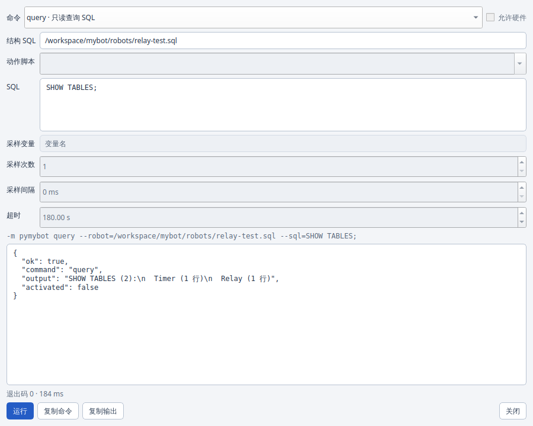
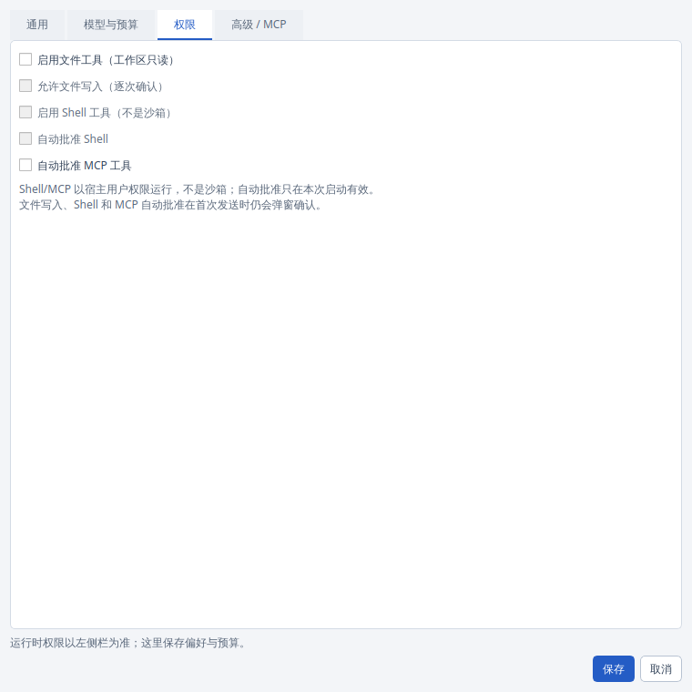
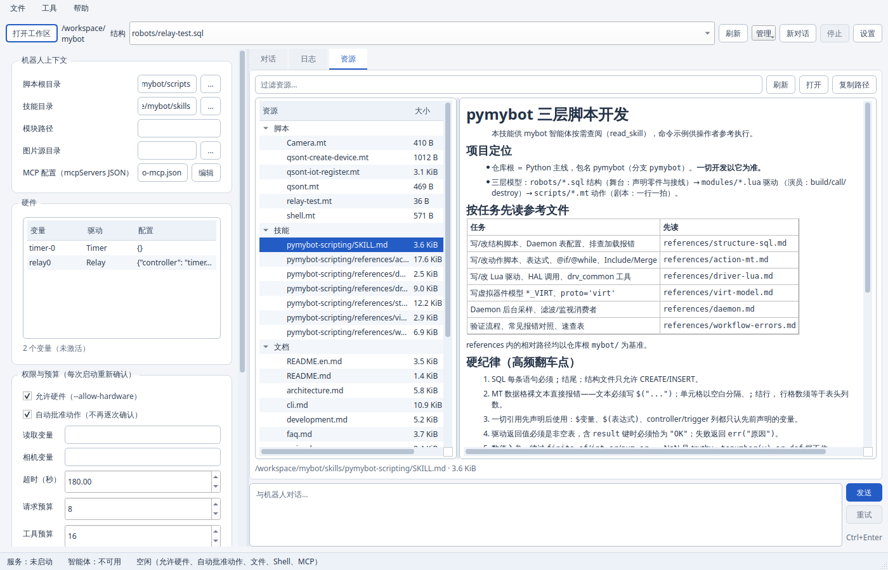
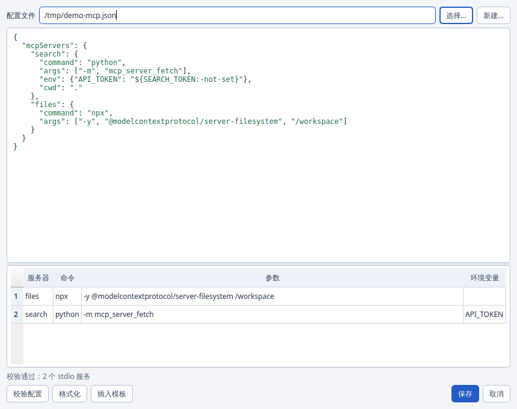
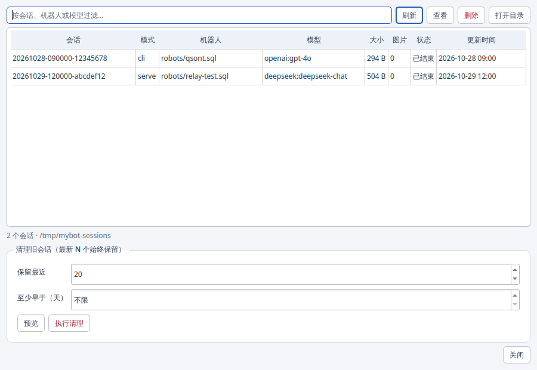
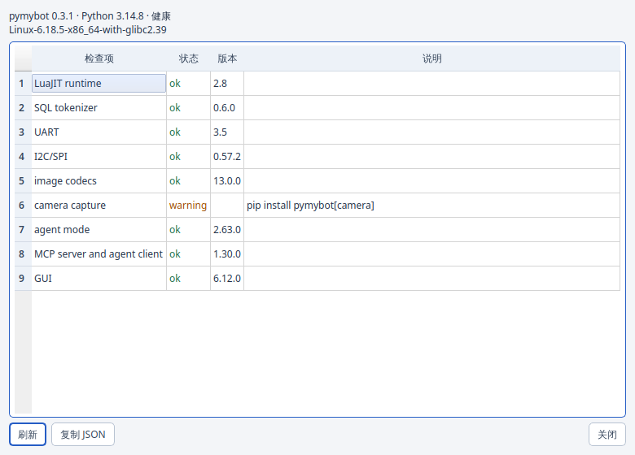

# GUI guide

The PySide6 (Qt 6) GUI is the default entry point for the Python reference edition:

```sh
pymybot            # opens the window
pymybot --no-gui   # terminal interface
```


## What the window contains

- **Menu bar** — 文件 (workspace, structure, refresh, settings, quit),
  工具 (MCP editor, sessions, diagnostics, resources, session folder, clear/copy
  chat) and 帮助 (docs, about). Every entry has a shortcut.
- **Toolbar** — workspace picker, structure SQL selector, refresh, a 管理 menu,
  new conversation, stop and settings.
- **Robot context** — scripts root, skills directory, module path, image source
  directory and MCP configuration.
- **Hardware tree** — variables, driver type and configured metadata, read from
  the selected structure without activating devices.
- **Permissions and budgets** — allow hardware, auto-approve actions, read
  variables, camera variables, timeout/model-request/tool-call/history budgets.
- **Advanced tool permissions** — workspace file tools, file writes, shell and
  MCP auto-approval, each separately gated.
- **Model summary** — current provider/model/endpoint/key-variable state.
- **Chat, logs and resources** — streaming transcript, tool receipts,
  diagnostics, and a lazy resource browser for scripts, skills and docs.
- **Status bar** — serve/MCP availability, busy state with an indeterminate
  progress indicator, active grants and notices.

## Management console

The GUI exposes the backend surface described in [cli.md](cli.md) and
[mcp.md](mcp.md); it does not duplicate robot logic.

| Entry | What it does |
| --- | --- |
| 设置 | Tabs for 通用 / 模型与预算 / 权限 / 高级·MCP: interpreter, structure paths, model endpoint/key variable, timeout, request/tool/history budgets, transcript switch, tool permissions and MCP file. |
| 工具 → 命令面板 | Exposes `check`, `hardware`, `scripts`, `query`, `run`, `sample`, `apply-sql`, `doctor` and `sessions` with dynamic fields, an argv preview, hardware confirmation and the JSON result. It builds argv with the same helper as the GUI's hardware call. |
| 工具 → MCP 配置 | JSON editor with syntax highlighting, the same `mcpServers` validator as the agent, a server table (environment values hidden), template insertion, formatting and atomic save. |
| 工具 → 会话管理 | Newest-first transcript table with filtering, transcript preview, per-session delete, dry-run/execute pruning, and a folder shortcut. |
| 工具 → 环境诊断 | Renders `pymybot doctor`: interpreter, assets and optional dependencies, colour-coded by status, with copy-JSON. |
| 资源 tab | Scripts, skills and source-tree docs in a filterable tree; Markdown is rendered with Qt's Markdown engine, scripts use a keyword/comment highlighter. Content is cached by mtime and reloaded only on demand. |
| 重试 | Re-sends the last task after an error, cancellation or timeout, disabled while a turn is running. |
| 清空 / 复制对话 | Clear the window transcript (after confirmation) or copy it to the clipboard. |
| 打开会话目录 | Opens `~/.mybot/sessions` in the file manager. |

Loading is incremental: the hardware tree, resource list and transcripts load on
demand or in background threads; stale results are discarded by generation
counters; resource reads are cached until the file changes. Streaming events are
appended only when the transcript is scrolled to the bottom, so reading history
is not interrupted by new tokens.

## First run

1. Install the GUI and agent dependencies (CLI-only environments can omit `gui`):

   ```sh
   python -m pip install -e ".[gui,agent]"
   ```

2. Open **设置** and choose:
   - the Python interpreter (leave empty to use the workspace `.venv` or the
     bundled interpreter);
   - the model, e.g. `openai:gpt-4o`, `openai-chat:my-model`,
     `anthropic:claude-sonnet-4-5` or `deepseek:deepseek-chat`;
   - the base URL only when using a self-hosted OpenAI-compatible endpoint;
   - the **name** of the environment variable holding the API key. The key
     itself is never stored in the settings file;
   - optional **变量覆盖** (`NAME=VALUE`, one per line) for structure
     `Alias`/`Vars` rows. They are applied before activation, passed to every
     agent action, kept in memory for this launch only, and never written to
     the settings file;
   - whether **保存会话转录** is enabled. It is on by default; turning it off
     starts `serve` with `--no-session-log`. `MYBOT_SESSION_LOG=0` in the
     environment still disables transcripts regardless of this checkbox. Use
     **工具 → 会话管理** or `pymybot sessions` to inspect or prune transcripts;
   - the retained history turns and history byte cap (`--history-turns`,
     `--max-history-bytes`);
   - advanced tool permissions and the MCP configuration file. The JSON editor
     validates with the same loader as the agent and never displays environment
     variable values.

3. Pick the workspace and a `robots/*.sql` structure. The hardware tree and
   model summary update immediately.

4. Type a task. Tool calls that can move hardware, write files or run shell
   commands show a confirmation dialog; closing the dialog means deny.

## Approval model

| Toggle | Effect |
| --- | --- |
| 允许硬件 | Opens physical devices / non-loopback HTTP / Shell driver. Confirmed before every turn. |
| 自动批准动作 | Pre-approves action scripts, variable reads and captures for this session. |
| 文件工具 | Exposes `list_files`/`read_file`/`write_file`/`edit_file` inside the workspace. Off by default. |
| 允许文件写入 | Pre-approves file creation/edits; confirmed once per launch. |
| Shell 工具 | Exposes the shell tool; requires file tools. **Not a sandbox.** |
| 自动批准 Shell | Pre-approves shell commands; confirmed once per launch. |
| 自动批准 MCP 工具 | Pre-approves external MCP calls; requires an MCP file and is confirmed once per launch. |

Tool availability preferences (文件工具 / Shell 工具) and budgets are persisted;
approval grants (硬件 / 动作 / 写入 / Shell / MCP) and the one-shot task are
**not**. Every launch starts closed, and a restart resets them. The agent still
asks for each tool call unless the matching auto-approval is on.

## Settings file

| OS | Location |
| --- | --- |
| Windows | `%APPDATA%\pymybot-gui\settings.json` |
| macOS | `~/Library/Application Support/pymybot-gui/settings.json` |
| Linux | `$XDG_CONFIG_HOME/pymybot-gui/settings.json` or `~/.config/pymybot-gui/settings.json` |

Only preferences are stored. API keys, variable override values, approval
decisions and hardware permissions are never written. A failed write is reported in the log and status
bar instead of failing silently.

## Architecture

The window owns no robot logic. It launches one long-lived
`python -m pymybot serve` child and speaks stdio JSON-RPC 2.0 to it. All reader
callbacks are dispatched to the Qt GUI thread. This keeps the UI responsive
during model streaming and hardware work.

Frozen Windows builds prefer the sibling `pymybot.exe` for the `serve` child;
the GUI executable itself has no console. See
[`development.md`](development.md#frozen-builds).

## Troubleshooting

| Symptom | Fix |
| --- | --- |
| “智能体不可用” | Install `.[agent]`; check the interpreter selected in settings. |
| Window opens but no model | Set `MYBOT_MODEL`/API key or configure them in settings. |
| Camera fails on Windows | Close other apps using the camera; some devices require running the app as administrator. |
| “启动中…” forever | Fixed in 0.2.0. On older builds, restart the window. |
| Missing PySide6 | Install `pymybot[gui]` (source checkout: `pip install -e '.[gui]'`). |
| No desktop display | Use `pymybot --no-gui` on headless Linux. |
| Qt xcb platform plugin cannot load | Install your distribution's Qt/X11 runtime libraries, including `libxcb-cursor0` on Debian/Ubuntu. |

## Limitations

- The resource browser is read-only: it previews scripts/docs but does not
  execute an action outside the agent or edit a driver.
- No sampling curves yet; use `pymybot sample` for repeated readings.
- One serve child per window; a restart briefly tears down the hardware session.
- The GUI is a front-end, not a sandbox. The same trust rules as the CLI apply.

## Screenshots

| View | Image |
| --- | --- |
| Main window (streaming chat, permissions, hardware) |  |
| Command panel (`query` example) |  |
| Settings (model/budgets, permissions) |  |
| Resource preview (scripts, skills, docs) |  |
| MCP configuration editor |  |
| Session manager |  |
| Environment diagnostics |  |
