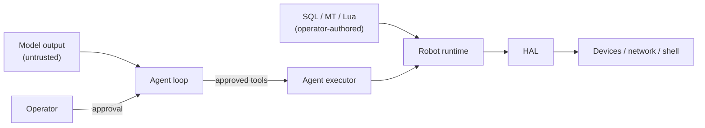

# Security model

pymybot is a local robot controller, not a multi-tenant service. This document
describes the trust boundaries the code tries to enforce and the limits the
operator must accept.

## Assets

- The robot and anything physically connected to it.
- The host account: files, network, environment and credentials.
- Model API keys and prompts.
- The integrity of scripts and drivers.

## Trust boundaries

| Boundary | Rule |
| --- | --- |
| Model → tools | Every action/read/capture is approval-gated unless the operator pre-authorised the session. File writes and shell have separate switches. |
| Model → files | Workspace tools reject traversal, links, special files and non-UTF-8; reads/writes are bounded. |
| Model → shell | Shell is opt-in, runs with host privileges, and is **not** a sandbox. |
| Model → network | Non-loopback HTTP requires `--allow-hardware`; redirects are refused; URL credentials/query/fragment are rejected. |
| Scripts → Lua | Lua is trusted code. LuaJIT FFI is available; only run reviewed drivers. |
| Driver → device | `active`/`build`/`destroy`/`sample` may write hardware even when they appear read-only. |
| Agent → logs | Final JSON excludes arguments, secrets and images; diagnostics are escaped. Session transcripts under `~/.mybot/sessions` do contain tool arguments, bounded results and images; API keys in environment variables are not read into them. See [`cli.md`](cli.md#session-transcripts). |

## System prompt ownership

The agent instructions are operator-owned. Neither the model, a tool result,
nor a remote app command can rewrite them: doing so would let untrusted content
grant itself new authority or remove approval rules. Operator-specific policy
belongs in reviewed skill files or a launch-time configuration controlled by the
person running the robot. Issue #5 (remote prompt replacement) is therefore
closed as a deliberate design decision, not an implementation gap.

## Credentials

- API keys are read from environment variables named by `--api-key-env` or the
  provider default; they are never accepted on the command line.
- Settings files store only the *name* of the key variable.
- A public binary cannot keep a secret. Do not ship a shared key; the withdrawn
  `gui-v1` binary is an example of what not to do.
- Rotate a key immediately if it was pasted into an issue, log or chat.

## Denial of service and physical safety

- Instruction budgets, wall-clock timeouts, bounded outputs and image limits
  exist, but cancellation cannot interrupt a blocking native driver call.
- A dispatched action is never claimed to be rolled back. If an exception
  occurs after dispatch, the result is “unknown”; the operator must inspect the
  robot.
- Shell timeouts kill the process tree best-effort; descendants that escape to a
  new session are not guaranteed to be killed.
- `--allow-hardware` is a capability switch, not a safety certification.

## Reporting

Use the private advisory link in [`../.github/SECURITY.md`](../.github/SECURITY.md). Include the
affected edition, commit, preconditions and a minimal reproduction. Do not open
a public issue for an exploitable problem.

## Hardening checklist for deployments

- Run as a dedicated unprivileged user; grant serial/FTDI/`i2c`/`spi` access
  explicitly.
- Keep the workspace read-only for the agent unless file writes are required.
- Leave `--enable-shell` and `--allow-shell` off by default.
- Disable session transcripts (`MYBOT_SESSION_LOG=0`) when prompts, files or
  camera images must not be kept on disk.
- Use a private model endpoint or a local model for sensitive data.
- Pin releases by SHA-256; verify `SHA256SUMS`.
- Review every Lua driver and skill before use.
