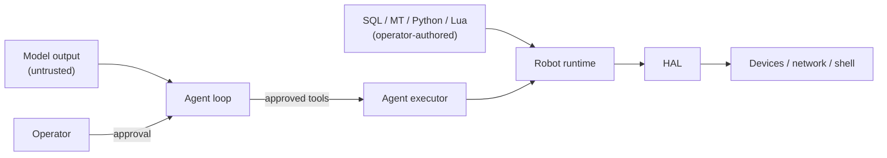

# Security model

pymybot is a local robot controller, not a multi-tenant service. This document
describes the trust boundaries the code tries to enforce and the limits the
operator must accept.

## Assets

- The robot and anything physically connected to it.
- The host account: files, network, environment and credentials.
- Model API keys and prompts.
- The integrity of scripts and drivers.

## Trust boundaries

| Boundary | Rule |
| --- | --- |
| Model → tools | Every action/read/capture is approval-gated unless the operator pre-authorised the session. File writes and shell have separate switches. |
| Model → files | Workspace tools reject traversal, links, special files and non-UTF-8; reads/writes are bounded. Agent prompt roots (runtime and bundled) reject generic reads/writes; use the dedicated prompt tools. |
| Model → shell | Agent shell is opt-in and requires usable bubblewrap with runtime/bundled prompt roots mounted read-only, including inside a writable workspace. If protection cannot be established, shell is refused; no unisolated fallback. Read-only mounts protect integrity, not confidentiality. |
| Model → network | Non-loopback HTTP/TCP requires `--allow-hardware`; TCP accepts only IPv4/IPv6 literals and has no implicit reconnect or replay. HTTP redirects are refused; URL credentials/query/fragment are rejected. Agent web tools are separate and opt-in: HTTPS only, private/loopback/link-local targets refused, every redirect re-validated, text-only bodies bounded to 512 KiB, and SearXNG is the only search provider. |
| MCP client → host | A stdio MCP server is operator-configured host code, not a sandbox. Every external tool call is approval-gated unless `--allow-mcp-tools`; results are bounded and failures are reported as unknown. |
| MCP client → pymybot | `pymybot mcp` is read-only unless `--allow-execution`; `--allow-hardware`, `--read-var` and `--camera-var` stay separate gates. Resources never grant execution. |
| Scripts → Python / Lua | Both are trusted in-process code. Python imports/direct native I/O are unrestricted; LuaJIT FFI is available. Neither is a security sandbox. |
| Driver → device | `active`/`build`/`destroy`/`sample` may write hardware even when they appear read-only. |
| Agent → logs | Final JSON excludes arguments, secrets and images; diagnostics are escaped. Session transcripts under `~/.mybot/sessions` do contain tool arguments, bounded results and images; API keys in environment variables are not read into them. See [`cli.md`](cli.md#session-transcripts). |

## Native driver trust

An ordinary SQL table selects `<Table>.py` before `<Table>.lua` **within each
configured root**, in root order. Review both the selected source and root order:
a Python file can supersede a same-root Lua driver. `check` compiles Python source
without executing it; it does not validate constructor behavior, imports, required
methods or safety. Activation executes a separate module and `Driver(context)`
instance per row, not a separate process or sandbox; imported packages can share state.

The native contract requires `build(data)` / `call(data)`, with optional `read(data)`
(fallback to `call`) / `destroy(data)`, returning a nonempty dictionary with optional
`result: "OK"` or `"ERR"`. `context.call(operation, *args)` retains HAL permission,
handle ownership/cleanup and cancellation checks. These checks do **not** constrain
Python imports or direct file, network, subprocess or native I/O. `--allow-hardware`
is a HAL gate, not a restriction on trusted Python code's host-account privileges.

I2C/SPI/UART/TCP/HTTP/Camera/Shell ordinary-table drivers use Python with the existing
HAL; native bus handles remain usable by Lua device drivers. Python I2C/SPI/UART
open virtual declarations as in-memory HAL handles with physical access disabled;
Lua device drivers retain their existing `virtbus` models and per-runtime isolation.
Existing Daemon chunks remain Lua-only and reject Python-selected drivers.

## System prompt ownership

Bundled defaults and their manifest are distributed as `prompts/` assets. Runtime
copies live in `$MYBOT_HOME/prompts` (default `~/.mybot/prompts`); initialization
copies missing defaults without overwriting operator edits. Composition is bounded
to 128 KiB, including generated context and guidance.

- **0 / 100 (safety prefix/suffix):** immutable to the agent. Runtime bytes are
  compared against trusted bundled hashes, not a runtime manifest supplied by the
  model. A modified safety file fails closed; editing its runtime manifest cannot
  authorize the change. Bundle validation also checks the trusted safety hashes.
- **10 (core):** operator-editable only, never writable by a model tool.
- **97 / 98 / 99 (SOUL / USER / STATS):** model-proposed changes use the dedicated
  `prompt:update_prompt` approval flow. Every call requires fresh approval,
  including its proposed diff; action, file, shell and MCP auto-approval never
  approve a prompt update. Denial, missing approval and cancellation do not write.
- Prompt updates use a hash-based compare-and-swap check, so an intervening edit
  requires a new proposal/approval. Backups retain prior bytes; audit events retain
  before/after hashes without copying prompt text into ordinary tool receipts.
- Automatic STATS updates are a separate **host-only** path: bounded, sanitized
  statistics, without tool arguments, prompt contents, credentials or secrets.
  Disable them with `--no-prompt-stats`, the GUI setting, or `agent.ask`
  `autoStats: false`. This does not grant model write authority.

`pymybot prompts list` reports hashes and modifications without loading a robot
or a model. `prompts restore --missing-only` preserves edits; `prompts restore
--all --yes` backs up and replaces runtime defaults, including a corrupt runtime
manifest or safety layer. Without `--yes`, full restore requires a TTY confirmation
and otherwise refuses. Protect backups like the originals: they can contain
private operator text. On POSIX, runtime directories/files use `0700`/`0600`.
`doctor` validates the bundle without creating a runtime home.

The agent's workspace tools reject both bundled and runtime prompt roots, and
reject writes to their ancestors. A workspace cannot itself be a prompt directory.
With prompt protection active, shell requires usable bubblewrap; `--sandbox off`
or an unavailable backend refuses execution, even after shell approval. Protected
roots are read-only after the workspace's writable mount, and linked prompt assets
are rejected. This is an integrity boundary: the shell's read-only host mount is
not a promise that other host files or prompt text cannot be read. Standalone
workspace APIs without protected roots retain the legacy non-OS-isolated fallback.

These checks are application boundaries, **not host-filesystem isolation**.
Trusted in-process Python/Lua drivers (including direct imports, native I/O and
LuaJIT FFI) and operator-configured external MCP servers remain host-account code.
They are not OS-sandboxed and can bypass application file APIs. Review them and
keep module/MCP configuration under operator control. Arbitrary remote replacement
of safety policy remains unsupported; editable memory layers do not supersede it.

## Credentials

- API keys are read from environment variables named by `--api-key-env` or the
  provider default; they are never accepted on the command line.
- Settings files store only the *name* of the key variable.
- A public binary cannot keep a secret. Do not ship a shared key; the withdrawn
  `gui-v1` binary is an example of what not to do.
- Rotate a key immediately if it was pasted into an issue, log or chat.

## Denial of service and physical safety

- Lua instruction budgets, wall-clock timeouts, bounded outputs and image limits
  exist. Python drivers use cooperative `context.check()` / HAL checks; call
  these regularly in long loops. Timeouts/cancellation cannot forcibly interrupt
  a blocking native call **or an uncooperative Python loop**. They are not a hard
  execution limit or a safety stop.
- A dispatched action is never claimed to be rolled back. If an exception
  occurs after dispatch, the result is “unknown”; the operator must inspect the
  robot.
- Shell timeouts kill the process tree best-effort; descendants that escape to a
  new session are not guaranteed to be killed.
- `--allow-hardware` is a capability switch, not a safety certification.

## Reporting

Use the private advisory link in [`../.github/SECURITY.md`](../.github/SECURITY.md). Include the
affected version, commit, preconditions and a minimal reproduction. Do not open
a public issue for an exploitable problem.

## Hardening checklist for deployments

- Run as a dedicated unprivileged user; grant serial/FTDI/`i2c`/`spi` access
  explicitly.
- Keep the workspace read-only for the agent unless file writes are required.
- Leave `--enable-shell` and `--allow-shell` off by default.
- Disable session transcripts (`MYBOT_SESSION_LOG=0`) when prompts, files or
  camera images must not be kept on disk.
- Use a private model endpoint or a local model for sensitive data.
- Pin releases by SHA-256; verify `SHA256SUMS`.
- Review every Python/Lua driver, its imports and every skill before use; keep
  trusted module roots out of agent-writable locations.
