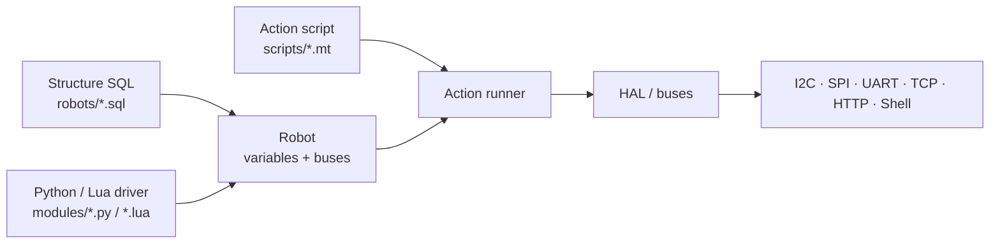
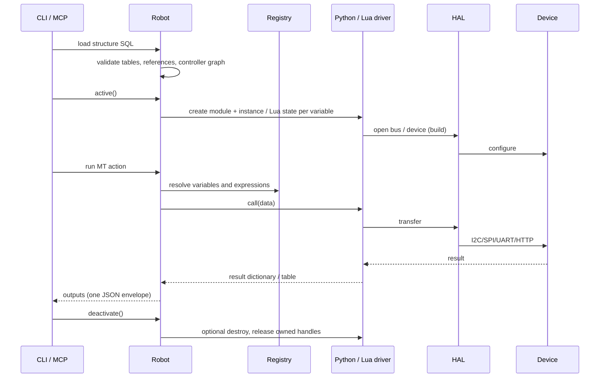
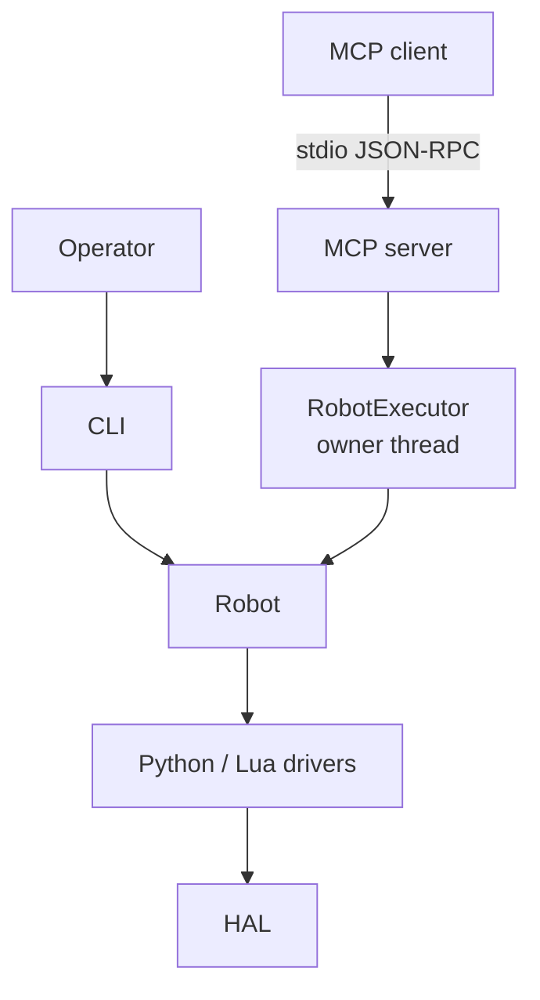

# Architecture

Source: This is the authoritative controller architecture document; the implementation lives in `scripts/pymybot/`.

pymybot separates *what the robot is* from *how a part is driven* and *what
should happen over time*. One Runtime serves exactly two entry points: the
Python CLI and the MCP stdio server.

## Three layers

| Layer | File | Responsibility | Trust level |
| --- | --- | --- | --- |
| Structure | `robots/*.sql` | Declares variables, buses, addresses and controller links | Operator-authored |
| Driver | `modules/*.py` / `*.lua` | Implements build/call and optional read/destroy | Trusted in-process code |
| Action | `scripts/*.mt` | Matrices of device parameters, captures, loops and control flow | Operator-authored |

Each ordinary SQL table selects `<Table>.py` or `<Table>.lua` from the configured
module roots (`--module-path`, repeatable). Roots are searched in order, **Python
before Lua within each root**; an earlier root's Lua beats a later root's Python.
`Alias`, `Vars` and `Daemon` retain their special handling. A row is a variable
instance. `$name` references a previously declared bus/controller, and `-`
inherits the previous row's value.

## Native Python contract

Activation executes the selected source in a fresh module namespace and creates
one `Driver(context)` instance **per SQL row**. `build(data)` and `call(data)` are
required; `read(data)` is optional and falls back to `call(data)`, optional
`destroy(data)` performs cleanup, and optional `safe(data)` is the best-effort
abort hook. Methods receive a dictionary of resolved metadata, action parameters
and trigger results as applicable, with `mode` set to the entry point. Return a
nonempty dictionary of JSON-compatible values; `result` may be omitted, or be
`"OK"` for success / `"ERR"` with `message` for failure.

`Robot.abort()` sets the runtime stop flag, calls `safe()` in reverse activation
order with a fresh bounded budget, then destroys every driver. It is not a
hardware emergency stop: a blocking native call or uncooperative Python loop can
still delay it. An aborted `Robot` is latched and must be replaced, not
reactivated.

`context.call(operation, *args)` uses existing HAL operations (for example,
`uart_read`, `i2c_transfer`, `close_handle`) with the same permissions, handle
ownership/cleanup and cancellation checks as Lua's HAL bridge. These are host
operation names, not the Lua convenience helpers. `context.check()` checks the
cooperative budget. Python is trusted, **not sandboxed**: imports and direct
native I/O are unrestricted; neither blocking native calls nor uncooperative
Python loops can be forcibly interrupted. Per-row module/instance isolation is
not process isolation; imported packages may share state.

The built-in I2C/SPI/UART/TCP/HTTP/Shell ordinary-table drivers use Python.
TCP declares only name/host/port; activation validates without connecting, and MT
explicitly controls connect/close, timeout/num_recv and hexadecimal/UTF-8 I/O.
Each TCP row opens its own stream; no endpoint-level connection sharing or replay.
HAL-backed buses expose the existing HAL handles to Lua device drivers rather
than creating a separate bus backend. Python I2C/SPI/UART drivers open buses
with `proto=virt` or a `virt-*` path as in-memory HAL handles with physical
access disabled, including legacy device-looking paths under explicit
`proto=virt`; they never fall back to physical hardware.
Lua device drivers retain their existing `virtbus` models and per-runtime
isolation. Other Python drivers do not automatically gain Lua virtual models.
Existing Daemon chunks remain Lua-only; static validation rejects a
Python-selected `driver` or `devices` entry rather than silently selecting a
different source.

## Runtime flow

The CLI drives `Robot` directly; the MCP server submits the same operations to a
`RobotExecutor` owner thread, which serialises them.

Key invariants:

- The whole CLI command emits exactly **one JSON line** on stdout. The MCP
  server instead reserves stdout for JSON-RPC. In both cases diagnostics go to
  stderr; Lua `print` and the Python driver's default `print` are redirected.
  Trusted Python code must keep direct/imported-library output off stdout too.
- `check`, `discover`, `hardware`, `scripts`, `query`, `doctor`, `new` and
  `assets` never activate drivers. Python source is compiled without execution;
  imports, constructors and method availability are not validated by this
  static check.
- `run`, `sample` and `apply-sql` activate the robot; activation itself may
  write to hardware.
- Driver calls are serialised per robot; daemon sampling uses dedicated worker
  threads with independent Lua states.
- An exception after an action starts is latched as “result unknown”; the
  runtime never claims a rollback.

## Python package map

| Module | Responsibility |
| --- | --- |
| `scripts/pymybot/cli.py` | Argument parsing, JSON contract, command dispatch, `doctor` and `assets` handlers |
| `scripts/pymybot/robot.py` | Structure loading, validation, activation and action execution |
| `scripts/pymybot/sql.py` | Strict in-memory SQL grammar and table operations |
| `scripts/pymybot/matrix.py` | MT action matrix parser and validator |
| `scripts/pymybot/actions.py` | Action runner: aliases, captures, control flow |
| `scripts/pymybot/expr.py` | Expression parser/evaluator and numeric rendering |
| `scripts/pymybot/include.py` | Include expansion and phase-based `.mt` matrix merging |
| `scripts/pymybot/hardware.py` | Identifier checks, budgets, variables, registry and metadata |
| `scripts/pymybot/runtime.py` | Shared HAL bridge, Lupa/LuaJIT (or standard-Lua) bootstrap and Python↔Lua conversion |
| `scripts/pymybot/native.py` | Compile-only validation, per-row Python modules, Driver context and results |
| `scripts/pymybot/hal.py` | I2C/SPI/UART/TCP/HTTP/Shell host operations |
| `scripts/pymybot/daemon.py` | Background Lua sampling workers and snapshots |
| `scripts/pymybot/discover.py` | Read-only host UART/FTDI/I2C/SPI enumeration and structure-SQL hints |
| `scripts/pymybot/paths.py` | Source/frozen asset resolution |
| `scripts/pymybot/security.py` | Bounded input reads and strict one-line JSON output |
| `scripts/pymybot/errors.py` | Controller exception hierarchy |
| `scripts/pymybot/process.py` | Platform shell-command and process-tree helpers used by the HAL Shell driver |
| `scripts/pymybot/scaffold.py` | `pymybot new` SQL/MT/Python skeleton generator |
| `scripts/pymybot/executor.py` | Single-owner `Robot` runtime that serialises MCP work on one thread |
| `scripts/pymybot/mcp_server.py` | Standard MCP stdio server over the executor (read-only by default) |

## Entry points

- **CLI controller mode** loads `Robot` in-process, executes one command and
  prints one JSON line; it never starts a server or a model. It is the automation
  entry point and is also available from the repository root as
  `python scripts/hardware_controller.py`.
- **MCP server mode** is a protocol adapter over `RobotExecutor`: a plain
  owner-thread runtime with no model, no approval callback and no tool loop. The
  operator fixes execution and hardware switches at launch, stdout carries only
  MCP JSON-RPC, and each process controls one structure file. `--allow-hardware`
  requires `--allow-execution`.

## Asset and path resolution

Controller sources live in `scripts/pymybot/`; `scripts/hardware_controller.py`
adds that directory to `sys.path` and is the self-contained launcher, and the
installed wheel exposes the same modules as the `pymybot` package. Default source
assets live in `assets/{modules,robots,scripts}`; the wheel copies those three
roots into `pymybot/assets/`. Module assets include both `.py` and `.lua`, and
`doctor` counts both. Frozen builds use `paths.py` and `sys._MEIPASS`; never rely
on the current working directory. Packaging is described by `pyproject.toml` and
`build_support.py`.

## Further reading

- [CLI reference](cli.md)
- [MCP server](mcp.md)
- [Security model](security.md)
- [Testing](testing.md)
- [Scripting reference](../SKILL.md)
