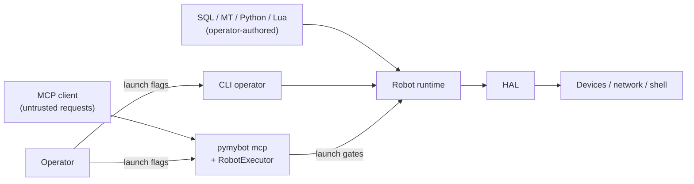

# Security model

Source: This is the authoritative controller security document; enforcement lives in `scripts/pymybot/`.

pymybot is a local robot controller, not a multi-tenant service. It exposes two
entry points: the Python CLI and the MCP stdio server. This document describes
the trust boundaries the code tries to enforce and the limits the operator must
accept.

## Assets

- The robot and anything physically connected to it.
- The host account: files, network, environment and credentials.
- The integrity of structure SQL, action scripts and drivers.

## Trust boundaries

| Boundary | Rule |
| --- | --- |
| Hardware gate | `--allow-hardware` is the only switch that opens physical I2C/SPI/UART devices, non-loopback HTTP/TCP and the Shell driver. Virtual buses (`proto='virt'`, `virt-*`), `loop://` UART and loopback HTTP/TCP stay available without it. |
| MCP client → pymybot | Requests are untrusted input. `pymybot mcp` is read-only unless the operator passes `--allow-execution`; `--allow-hardware` is separate and requires `--allow-execution`. Tool arguments, read-only SQL and `.mt` paths are validated and bounded; resources never grant execution. |
| Controller → network | TCP accepts only IPv4/IPv6 literals and has no implicit reconnect or replay. HTTP redirects are refused; URL credentials/query/fragment are rejected. |
| Shell driver → host | The Shell ordinary-table driver runs commands with the host account's privileges and is not a sandbox; it requires `--allow-hardware`. Output is capped and the process tree is killed best-effort on timeout. |
| Scripts → Python / Lua | Both are trusted in-process code. Python imports/direct native I/O are unrestricted; LuaJIT FFI is available when the `lupa` wheel includes LuaJIT (otherwise a standard-Lua fallback has no FFI). Neither is a security sandbox. |
| Driver → device | `active`/`build`/`destroy`/`sample` may write hardware even when they appear read-only. |

## Native driver trust

An ordinary SQL table selects `<Table>.py` before `<Table>.lua` **within each
configured root**, in root order. Review both the selected source and root order:
a Python file can supersede a same-root Lua driver. `check` compiles Python source
without executing it; it does not validate constructor behavior, imports, required
methods or safety. Activation executes a separate module and `Driver(context)`
instance per row, not a separate process or sandbox; imported packages can share state.

The native contract requires `build(data)` / `call(data)`, with optional `read(data)`
(fallback to `call`) / `destroy(data)`, returning a nonempty dictionary with optional
`result: "OK"` or `"ERR"`. `context.call(operation, *args)` retains HAL permission,
handle ownership/cleanup and cancellation checks. These checks do **not** constrain
Python imports or direct file, network, subprocess or native I/O. `--allow-hardware`
is a HAL gate, not a restriction on trusted Python code's host-account privileges.

I2C/SPI/UART/TCP/HTTP/Shell ordinary-table drivers use Python with the existing
HAL; native bus handles remain usable by Lua device drivers. Python I2C/SPI/UART
open virtual declarations as in-memory HAL handles with physical access disabled;
Lua device drivers retain their existing `virtbus` models and per-runtime isolation.
Existing Daemon chunks remain Lua-only and reject Python-selected drivers.

## Credentials

pymybot is a hardware controller: it has no model or provider credentials and
makes no model calls of its own. Driver credentials (device passwords, API
tokens) are ordinary operator data.

- Prefer `--var-env NAME=ENVVAR` over `--var NAME=VALUE` for a secret: the value
  stays out of argv, process listings and shell history, and injected values are
  never written back to the structure file.
- The success envelope does not add bindings of its own, but driver errors and
  device output are only as private as the data you give them. Do not paste
  hardware or driver output containing secrets into issues, logs or chat.
- A public binary cannot keep a secret. Do not ship a shared credential.
- Rotate a credential immediately if it was pasted into an issue, log or chat.

## Denial of service and physical safety

- Lua instruction budgets, wall-clock timeouts, bounded outputs and list/sample
  caps exist. Python drivers use cooperative `context.check()` / HAL checks; call
  these regularly in long loops. Timeouts/cancellation cannot forcibly interrupt
  a blocking native call **or an uncooperative Python loop**. They are not a hard
  execution limit or a safety stop.
- The CLI's SIGINT/SIGTERM stop and MCP request cancellation are best-effort
  operator stops: they set the stop flag, call optional driver `safe()` in
  reverse activation order, then release handles. The MCP `deactivate` tool is
  ordinary cleanup and does not call `safe()`. None of these is a hardware
  emergency stop and none must be used as a safety-rated interlock. A blocked
  native call can delay them indefinitely; keep a physical E-stop and
  independent safety circuit for any machine that needs one.
- A dispatched action is never claimed to be rolled back. If an exception
  occurs after dispatch, the result is “unknown”; the operator must inspect the
  robot. The MCP executor additionally latches a fault and refuses further work
  until the operator restarts the process; nothing retries automatically.
- Shell timeouts kill the process tree best-effort; descendants that escape to a
  new session are not guaranteed to be killed.
- `--allow-hardware` is a capability switch, not a safety certification.

## Reporting

Use the repository's private security advisory channel (GitHub: Security →
Report a vulnerability). Include the affected version, commit, preconditions and
a minimal reproduction. Do not open a public issue for an exploitable problem.

## Hardening checklist for deployments

- Run as a dedicated unprivileged user; grant serial/FTDI/`i2c`/`spi` access
  explicitly.
- Leave `--allow-hardware` off unless the run needs physical devices; run the MCP
  server without `--allow-execution` unless a client must act on the robot.
- Scope each `pymybot mcp` process to one robot and one scripts root; restart it
  to clear a latched fault.
- Review every Python/Lua driver and its imports before use; keep trusted module
  roots (`--module-path`) out of untrusted-writable locations.
- Install from a pinned artifact and verify its SHA-256 when one is published.
